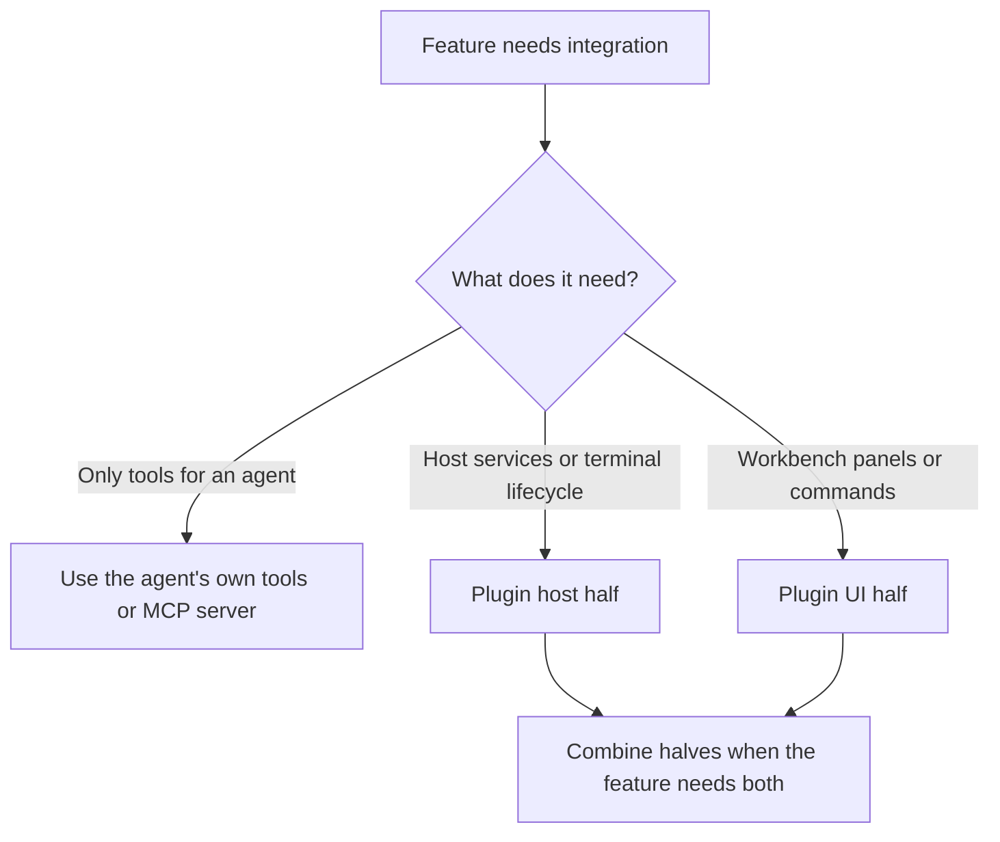
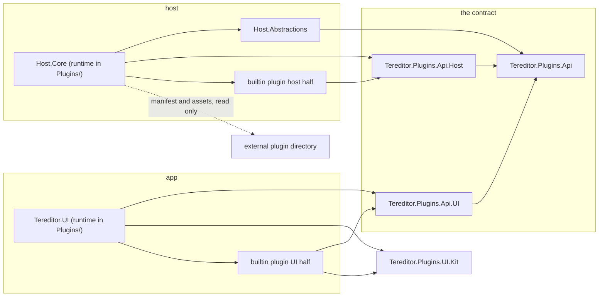
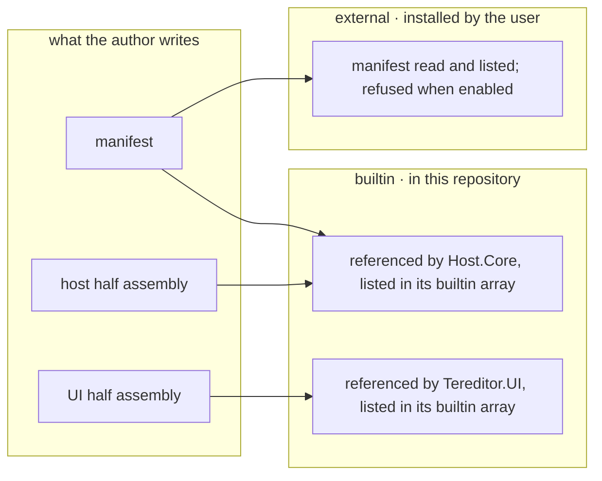
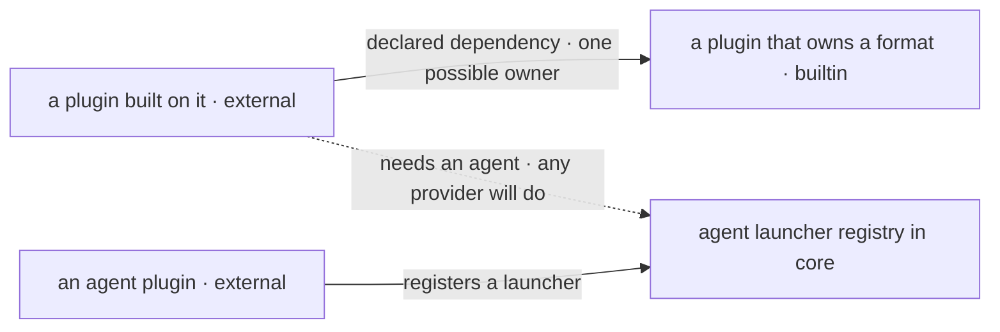
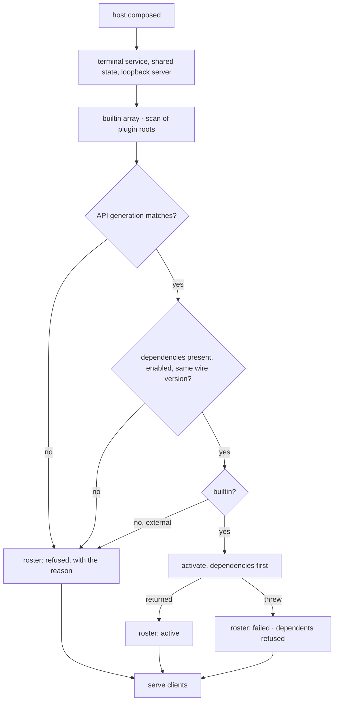
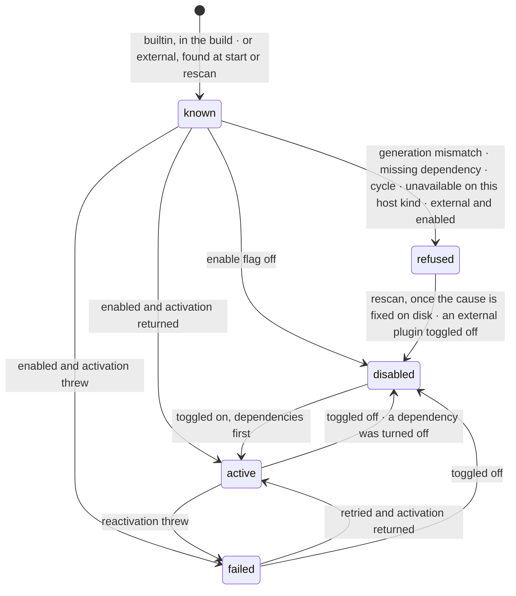
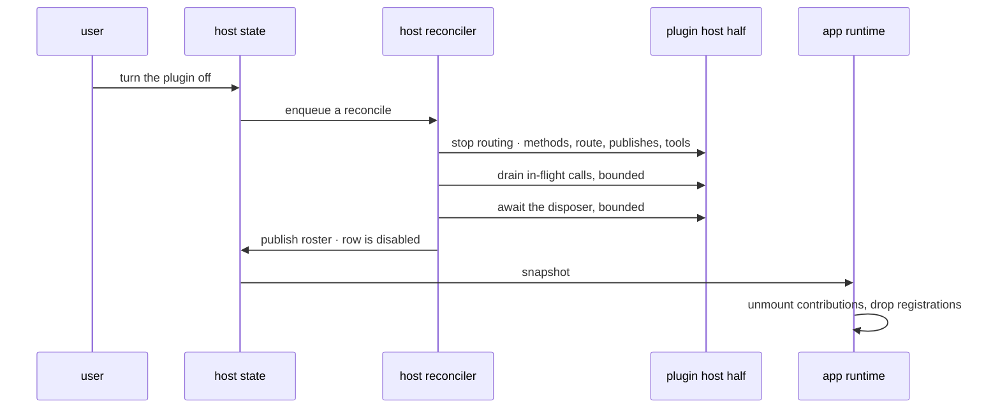
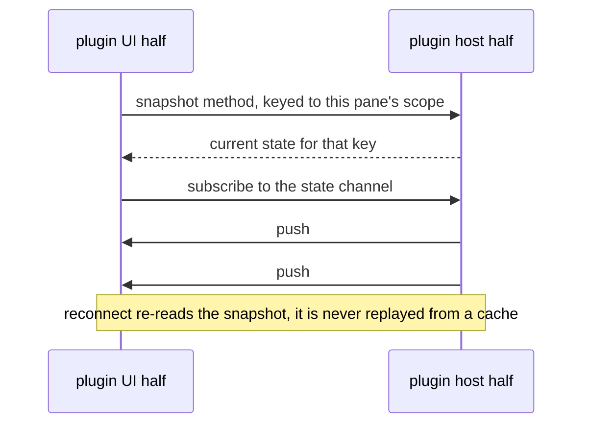
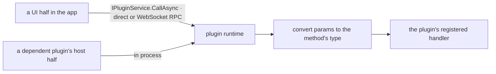
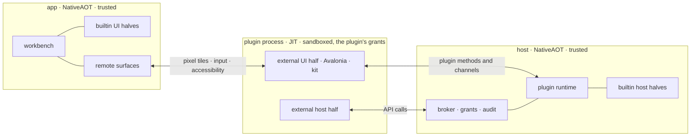

# Plugin API — the contract between the host, the app, and a plugin

Plugins add features to tereditor without building them into every host and window. A plugin can
provide host operations, terminal integrations, settings and UI surfaces. It has a manifest plus
a host half, a UI half, or both. Builtin plugins are compiled into the app and the remote host, and
each can be enabled or disabled without restarting. Separately installed plugins are discovered and
listed, but refused until they can run isolated from tereditor's processes.

The host half runs where the project files and shells live; the UI half runs in the app. A remote
connection must preserve that boundary. The API defines what each half may do and how they
communicate; it does not implement the runtimes themselves.

Read [when to use a plugin](#when-something-should-be-a-plugin) and [stability](#stability) first.
The remaining sections are the detailed authoring contract: names, capabilities, lifecycle and
failure rules. Exact signatures belong in generated API documentation and analyzer baselines.
The builtin Specs plugin and a check-only fixture plugin exercise these same boundaries.

## Responsibility

Three contract assemblies separate shared vocabulary, host capabilities and UI capabilities.
They contain types and identity helpers, with no runtime of their own. The
[host runtime](../Tereditor.Host.Core/Plugins.SPEC.md) and
[UI runtime](../Tereditor.UI/Plugins/SPEC.md) connect those contracts to host services, shells,
shared state and the workbench.

### When something should be a plugin

Existing extension points come first. An agent capability that needs nothing of tereditor is an MCP server or
a tool in the agent's own configuration; it needs no tereditor code. This API covers what such a tool cannot do
on its own: own host methods and channels, mount an HTTP route terminals reach, stamp terminal environment,
observe host lifecycle, hold settings and state, and contribute UI.

The distinction applies per capability, not per feature. A feature whose agent side is already portable can
still own a plugin for everything around it.

### Builtin and external plugins

A builtin plugin lives in this repository, ships inside the app and the remote host, and is updated in the same
commit that changes this contract. An external plugin is owned by someone else, released on their schedule,
and installed by a user.

Both declare the same manifest, receive the same capabilities, and appear in the same roster. Ownership affects
trust and lifecycle only: whether the manifest's default enablement is honoured, whether the API generation is
guaranteed to match, and what the user is told they are trusting. Delivery follows from ownership rather than
defining it.

Capability parity is deliberate. Most of the features this contract is measured against are external work, so
a capability restricted to builtin plugins would be unavailable to almost every consumer it has.

External plugins do not run in this version. The host discovers them and lists them in the roster, and refuses
one that is enabled, with the reason "External plugins are not supported in this version." Neither the host nor
the app loads an external assembly, so both are free of dynamic code loading and can be published as
NativeAOT. External plugins come back once they can run isolated from tereditor's processes
([Isolated runtime](#isolated-runtime)); the checks already run one with only a UI half that way. Until then, the
manifest format and the capabilities stay as described here.

## Stability

This API carries no compatibility promise yet. There is no semantic versioning, no deprecation window, no
shims, and no commitment to keep a capability that stops being used. Any release may rename, reshape, or remove
anything described here, including the UI kit a plugin's UI is built against.

`PluginApi.Generation` records the shape a plugin was built against. It is declared in the manifest
(`ApiGeneration`), incremented with any breaking change, and checked before load. A mismatch is refused and
reported, rather than allowed to half-load and fail somewhere further from the cause. Builtin plugins are
updated alongside it; external plugins are expected to break on upgrade and are told so directly. Since any
upgrade can therefore disable somebody's plugin, the refusal names the plugin, the generation it declares, and
the generation the host is on, or it reads as the app quietly losing features.

Two guarantees do hold. The wire stays versioned per plugin (`WireVersion`), because a remote host and the app
ship independently. Persisted state stays readable across a generation change, because user data is not part
of the API.

### API validation

`TerminalAgentRecord.LaunchedByUi` is nullable launch provenance: true for a detected UI launch,
false for a detected manual launch, null when unknown. Hosts persist and broadcast it, including over
WebSocket RPC. Providers determine it independently of optional prompts or MCP settings; status-only updates
retain it. Older state and hosts leave it unknown rather than mislabelling sessions.

`TerminalAgentRecord.Model` and `Effort` retain the latest choices reported by the session for
revival. Both persist and cross WebSocket RPC; an absent field in a later report preserves the known value
for that session. A new session does not inherit the previous session's choices.

No stability promise is not the same as no accounting. Every change to the plugin-facing surface has to be
visible in review.

The plugin-facing API, UI kit and shared agent UI assemblies run
`Microsoft.CodeAnalysis.PublicApiAnalyzers` against a committed `PublicAPI.Shipped.txt` /
`PublicAPI.Unshipped.txt` pair listing every public symbol with its signature. Because warnings are errors, a
public symbol missing from the listing (RS0016) or a listed symbol that no longer exists (RS0017) fails the
build. Since nothing is shipped under a compatibility promise, every entry lives in `PublicAPI.Unshipped.txt`;
`Shipped` stays empty. `dotnet format analyzers <project> --diagnostics RS0016` rewrites the listing after a
deliberate change.

Specs describe behavior and compatibility policy, not declarations. The API validator owns declaration
accounting; Markdown is not compared to compiled types. The validator makes declaration changes
visible in review; the reviewer decides whether a change is acceptable. One rule is written down for that judgement: removing a member, narrowing a
parameter, or widening a return is a breaking change and has to come with a generation bump. The checks pin
`PluginApi.Generation`'s value, so a breaking change fails them until someone bumps it deliberately.

## Boundary

- Owns: the contract vocabulary. A plugin declares one `PluginContract` naming its methods, channels, settings
  type and wire version. These assemblies own that shape, the manifest and roster shapes, the naming rules
  below, the tool shape, and the two context interfaces.
- Three assemblies separate shared vocabulary, host operations and UI contributions. Host and UI
  entries do not reference each other. Shared vocabulary includes plugin identity, manifests,
  methods, channels, settings, roster state, agent facts and project/workspace metadata.
  Plugins obtain the new-worktree directory from the host, including remote hosts and custom state
  directories, rather than deriving a path beside the checkout.
- Allowed deps: the .NET base library for the root and host entries; the root entry, and Avalonia's `Control`
  types, for the UI entry.
- Forbidden: any `Tereditor.Host.*` or `Tereditor.UI` project, ASP.NET Core, WebSocket RPC or protobuf types,
  Avalonia in the root or host entry, and any runtime beyond identity helpers and name builders
  (`PluginJson`, the registry of generated JSON metadata with its conversions, and `PluginTool<T>.RunAsync` are
  the exceptions they need). The UI kit is a
  separate assembly ([SPEC.md](../Tereditor.Plugins.UI.Kit/SPEC.md)), since controls here would make it a
  dependency of every host half.
- Dependents: `Tereditor.Host.Abstractions` references the root entry, because `HostState` carries the roster
  and agent records and `IPluginService` speaks in them; this is the edge the fork had in the other direction
  (its roster types lived in `contracts` and were re-exported). Records here are shared rather than mirrored in
  Abstractions so there is one definition.

### Reference documentation

Every public symbol of the three entries carries an XML doc comment: what it is for a plugin author, the rules
that bind it, and `<param>`/`<returns>`/`<example>` where they earn their place. `GenerateDocumentationFile`
makes a missing comment (CS1591) a build error. This is the one deliberate exception to the low-comment rule in
`AGENTS.md`: the readers are external plugin authors, who read the documentation their editor shows rather than
this spec. The spec stays the design record and the source of every rule; the comments are its per-symbol
reference, derived from it rather than duplicating its rationale. The kit is not enrolled in this rule.

### Contract boundaries

`IPluginLogger`, `PluginDisposer`, `PluginCall`, `TerminalEvent` (`TerminalSpawned`, `TerminalExited`, `TerminalClosed`, `TerminalAgentChanged`), `TerminalProcess`, `RevivePrefill`, `WorkspaceEvent` (`WorkspaceCreated`, `WorkspaceUpdated`, `WorkspaceRemoved`), `WorkspaceFilesChanged`, `GitRunOptions`, `GitRunFailure`, `GitRunResult`, `PluginHttpRequest`, `PluginHttpResponse`, `IPluginHostContext`, `PluginHostModule` |
| `Tereditor.Plugins.Api.UI` | `IPluginUILogger`, `PluginDisposer`, `PluginAppSettings`, `TerminalTabInfo`, `PluginHostProjection`, `EditorKind`, `EditorRef`, `EditorSelection`, `EditorLifecycle`, `EditorEvent` (`EditorLifecycleEvent`, `EditorSelectionEvent`), `EditorOpenOptions`, `CompanionHost`, `TerminalKeyEncoding`, `ITerminalAccessoryApi`, `LauncherModel`, `LauncherCommandOptions`, `LauncherAvailability`, `AgentLauncher`, `FileIconKind`, `GitDiffScope` (`BranchDiffScope`, `UncommittedDiffScope`, `CommitDiffScope`, `PinnedDiffScope`), `TerminalOpenOptions`, `FilePickOptions`, `PluginNotificationKind`, `AttentionNotification`, `IPluginPreference`, `FileViewerProps`, `FileViewerRegistration`, `SettingsSectionRegistration`, `SideToolRegistration`, `CompanionRegistration`, `TabDecoration`, `TabRef` (`TerminalTabRef`, `ToolTabRef`, `FileTabRef`), `WorkspaceActionRegistration` (`WorkspaceScopedActionRegistration`, `ProjectScopedActionRegistration`), `TerminalAccessoryRegistration`, `IPluginEditors`, `IPluginUIContext`, `PluginUIModule` |

`IPluginLogger` and `IPluginUILogger`, and the two `PluginDisposer` delegates, are declared independently with
the same shape rather than shared, since the host and UI entries do not reference each other. The host disposer
returns a `ValueTask` (a toggle awaits it); the UI one is synchronous, as the fork's web disposer was.

An arrow means "may depend on". There is no edge from a plugin to any `Tereditor.Host.*` or `Tereditor.UI`
project, none between two plugins' host halves, and none from a UI half into the app's state, transport or
workbench.

### Names that are part of the contract

| what | shape |
| --- | --- |
| method and channel | `plugin.<id>.<name>` (`PluginIdentity.MethodName`/`ChannelName`); the generic call carries id and name separately |
| HTTP route | `/plugin/<id>/<subpath>` on the host's loopback HTTP/1.1 server (`PluginIdentity.Route`) |
| side-tool id in a layout | `plugin:<id>:<tool>` (`PluginIdentity.ToolId`/`ParseToolId`) |
| host settings | `HostState.PluginSettings[<id>]`, with `enabled` reserved to core |
| extra plugin roots | `HostState.PluginPaths` |
| host state files | `<stateDir>/plugin-state/<id>/<name>.json` (`PluginIdentity.StateFile`) |
| external plugin on disk | `<stateDir>/plugins/<id>/`, manifest `tereditor-plugin.json` (`PluginManifest.FileName`) |
| client-local preference keys | `plugin:<id>:<key>` (`PluginIdentity.PreferenceKey`), endpoint-qualified, in the profile |
| builtin plugin assets | `plugins/<id>/<assets>` under the app's and the remote host's output directory |
| core roster wire | `HostState.Plugins` on every snapshot; `IPluginService.ListAsync`, `RescanAsync`, `RetryAsync` |

`<stateDir>` is the host state directory: `~/.tereditor` for the app's own host, `TEREDITOR_STATE_DIR` for a
remote host. An id is lowercase alphanumeric with hyphens. For an external plugin it must equal its directory
name, so the id cannot claim more than the user placed there. Code and state live in sibling trees, so
replacing a plugin does not disturb the state it wrote.

## What a plugin is

A plugin is a manifest plus a host half, a UI half, or both. A plugin with no host half is an ordinary case
rather than an exception.

### The manifest

`PluginManifest` is the same fields with two carriers: a builtin plugin constructs the record in code, and an
external plugin ships the same fields as `tereditor-plugin.json`, read with `PluginJson.Options` (camelCase
names and enum values, unknown members refused).

| field | meaning |
| --- | --- |
| `id` | the namespace for every name above; for an external plugin it must equal its directory name |
| `label` | shown in the roster and Settings › Plugins |
| `description` | optional one sentence, shown under the label in Settings |
| `icon` | a Remix Icon name, or `asset:<path>` naming an SVG or PNG under `assets` (builtin language server plugins name the mark Code Intelligence shows); an unknown name falls back to a generic glyph, which keeps the icons-only invariant without admitting arbitrary drawing |
| `category` | optional group Settings › Plugins lists the plugin under. The builtin names are `PluginCategories`: one per language (`Python`, `JavaScript & TypeScript`, `JVM`, `C & C++`, `C#`, `CSS`, `Dart`, `Go`, `PHP`, `PowerShell`, `R`, `Ruby`, `Rust`, `Shell`, `Swift`), then `Environment`, `Agents`, `Model providers`, `Version Control`, `Specs & Documents` and `Integrations`; any other name is its own group and none means `Other`. All the plugins of one language share its category, so a language server and the plugin that activates that language's environments sit together. Each builtin category also names an icon in `PluginCategories.Icons` (a core icon of the plugin UI kit); Settings › Plugins shows it before the category's chip. The letter languages (`C & C++`, `C#`, `CSS`, `Go`, `JavaScript & TypeScript`, `PHP`, `R`) name none, as their chips already spell the letters, and show no icon. Other names get the puzzle glyph |
| `support` | optional support level; `early` (`PluginSupportLevels.Early`) marks basic support, shown as an "Early support" badge on the plugin's Settings › Plugins card. Absent means fully supported. It travels in the roster (`PluginRosterEntry.Support`, wire field 17) |
| `icon` | a Remix Icon name, or `asset:<path>` naming an SVG under `assets`; an unknown name falls back to a generic glyph, which keeps the icons-only invariant without admitting arbitrary drawing |
| `version` | the plugin's own version, informational |
| `apiGeneration` | refused before load if it does not match `PluginApi.Generation` |
| `wireVersion` | incremented when the plugin's methods or channels change, so a separately shipped half can detect drift |
| `enabledByDefault` | honoured for builtin plugins; an external plugin always arrives disabled |
| `headless` | whether the plugin works in headless tereditor, which has no window, terminal or agent of its own: `yes`, `no` or `undeclared` (the default). A builtin must say `yes` or `no`, and a headless host (`HostKind.Headless`) runs only plugins that say `yes`, refusing the rest and their dependents. An external plugin that says nothing is not headless |
| `headlessEnabledByDefault` | optional; replaces `enabledByDefault` on a headless host, so a headless plugin can start on there while a desktop leaves it off |
| `agentRouting` | optional, for an agent plugin: what its model can come from. A list of `accepts` (API kind, how a provider is injected, which credentials it takes: `api-key`, `oauth`) and `ownLogin`. Kinds are `anthropic-messages`, `openai-responses`, `openai-chat`, `google-generative`, `vertex` and `bedrock`; injections are `settings-file`, `config-override` and `models-file`. It is plain data in the roster, so it exists whether or not any plugin reads it. An agent never depends on a plugin that fills it in; tereditor never translates one API kind into another |
| `dependsOn` | other plugins, by id and exact wire version |
| `unavailableOn` | host kinds the plugin cannot run on (`pureWeb`: a host that lives in a browser tab with no operating system under it). A host of a listed kind refuses the plugin before load, naming the kind, and refuses its dependents with it; empty means everywhere. A plugin that needs a shell, a process or a socket lists `pureWeb` |
| `host`, `ui` | relative paths of the two entry assemblies; each holds exactly one public concrete `PluginHostModule` / `PluginUIModule` subclass. An external plugin's are never loaded in this version |
| `assets` | optional directory the host hands the host half (`AssetsDirectory`) and serves to the UI half (`ReadAssetAsync`, W19), for either origin |
| `contributes` | the statically known parts: side tools with label, icon, default side and whether they need Git; file viewers with extensions, names and read strategy |
| `pi` | ThinkRail's agent block; parsed so a shared manifest reads, and ignored, since tereditor has no in-process agent |

`contributes` exists because two rules below need a contribution to be known before any plugin code runs: the
file-open path picks a read strategy while restoring a window's tabs, before plugins activate, and the layout
has to name a side tool in order to render a dormant placeholder. Parts that need code, such as the control or
a finer predicate, are registered by the UI half during activation.

The fork's `styles` field has no counterpart: an Avalonia UI half carries its styles as compiled XAML inside
its own assembly.

### Delivery

Both paths hand the halves the same contexts. A builtin plugin is a set of projects (contract, host half, UI
half) under `src/`, with its own `SPEC.md`; its host half may not reference `Tereditor.Host.*`, and its UI half
may not reference `Tereditor.UI`, which project references make checkable rather than conventional. An external
plugin is a directory holding the manifest, the built assemblies with their own dependencies, and any assets.
tereditor reads its manifest and its assets, and never loads its assemblies into the host or the app.

### The shared UI runtime

A UI half cannot carry its own copy of Avalonia, the API or the kit, because two copies of an assembly in one
process are two sets of types: a `Control` from the plugin's copy is not a `Control` to the app. Three rules
follow, replacing the fork's window registry and stylesheet rules.

Every UI half is compiled into the app through the builtin array, so it binds to the app's own Avalonia, API
assemblies and kit, and types unify. Nothing loads an assembly into the app at runtime: an external UI half
is not loaded at all, since a separate copy of the UI runtime is what isolation from the app would need.

A plugin styles itself with the kit's brushes and fonts (`Ui`), which are what a theme change rewrites. A
plugin that writes literal colours will stop following theme changes, and nothing will report it.

The UI kit is a real assembly, `Tereditor.Plugins.UI.Kit`. It carries the primitives and the heavy shared
pieces: the Markdown renderer, the code editor frame, and the diagram view. It is the single home for the
primitives the app uses, and the app uses them from it, because two copies would drift. The theme catalogue
stays in the app; the kit owns the brush tokens a theme writes, which makes the token names a contract
documented in the kit's own spec.

### Trust

Discovery reads one directory, `<stateDir>/plugins`, plus any extra roots in `HostState.PluginPaths`. Projects,
worktrees, and repository checkouts are never scanned, so a cloned repository cannot place executable code in a
host. A builtin plugin is code in the host process and in the app; an external plugin's code runs in neither.

A discovered plugin is listed in Settings › Plugins as installed and off, with its label, version, any manifest
problems, and its declared contributions. Enabling it refuses it with its reason, and nothing loads. Nothing
enables an external plugin automatically, including a project, a settings change from another client, or an
upgrade.

There is no sandbox. A host half runs in the host process with its privileges and without crash isolation,
and a UI half runs in the app, so a fault can take down the host or the app. A builtin plugin is trusted as
part of the build. An external plugin is not run until it can run isolated from tereditor's processes.

### Depending on another plugin

One plugin may be built on another: a document format owned by one plugin, consumed by a second. That names one
specific plugin rather than a behaviour any provider could supply, and it is ordinarily a dependency across
ownership, external on builtin.

A dependency is declared in the manifest and grants three things.

- Presence and order. A plugin whose dependency is absent, disabled, failed, refused, or at a different wire
  version is refused, and the reason names the dependency. Activation runs dependency-first and disposal
  dependent-first in both runtimes. A cycle is refused at load.
- Types. The dependent may reference the dependency's contract project. For a builtin dependency that is a
  project reference; for an external one it is a copy of the contract the dependent's author vendors, where the
  wire version makes drift visible. Because payloads cross as JSON, two copies of a contract interoperate.
- Calls. The dependent may invoke the dependency's declared methods and subscribe to its channels through
  `Dependency(contract)`. In the app this is the ordinary plugin call path. On the host the runtime dispatches
  in process.

A dependency grants nothing beyond those three. It does not reach the other host half, share objects, or
register into the dependency's surfaces. The grant is wire-level, so it does not cover a synchronous
render-time provider in the app; those are registered into a core slot instead, which is how one plugin's file
icons reach another plugin's file picker without a plugin-to-plugin edge.

A plugin cannot be enabled while a dependency is off, and the Settings toggle offers to enable both. Turning a
dependency off also turns off its dependents, which are named first. Turning it back on re-enables exactly those
that were on before, since the host remembers them as suspended; a dependent the user had off, or switched
themselves meanwhile, is left as the user set it.

Dependencies make one plugin's failure into another's, and a dependency chain is a load-order constraint in a
system that otherwise has none. Two edges are manageable. A third is the point to ask whether the shared part
belongs in core instead.

Where several plugins could satisfy a need, a core contribution point is preferable to a dependency. A feature
that needs an agent to author with, where any agent plugin would do, goes through the launcher registry (W9). A
feature that needs one specific plugin's format declares a dependency. The test is whether the need names a
capability or a particular plugin.

### Allowed dependencies of a plugin

A host half may depend on the root and host entries, a dependency's contract, and exact-pinned third parties.
It may not depend on any `Tereditor.Host.*` project, `Tereditor.UI`, or another plugin's host half. Git goes
through `GitAsync`; everything else a host half needs (sockets, files, processes) is ordinary .NET.

A UI half may depend on the root and UI entries, the UI kit, Avalonia, a dependency's contract, and its own
third parties. It may not reach the app's state, transport, workbench or panels. It reaches the app through the
UI context alone, which is what allows it to live outside this repository.

## Enforcement

1. Project references are the boundary. The API projects, the kit and each builtin plugin's projects reference
   only what this spec allows, and `Tereditor.slnx` holds them all, so an illegal edge is a missing reference
   and a build error rather than a review comment.
2. The public-API listings and `GenerateDocumentationFile` (see Stability) fail the build on an unlisted or
   undocumented public symbol.
3. The checks pin `PluginApi.Generation`, and assert that an external plugin in a temporary plugin root is
   listed, refused when enabled with its reason, and loads no code.
4. Plugin checks live in `tests/Tereditor.Checks` beside the other host and UI checks. The fixture plugin's
   projects live under `tests/`, and the checks compose them as a check-only builtin on both sides, so every
   capability path runs as it does for a shipped plugin. The fixture never ships in the app.

## Loading, composition, the enable gate

Builtin plugins are composed statically in both runtimes: a literal array of host halves in
`Tereditor.Host.Core/Plugins/BuiltinPlugins.cs`, and a literal array of manifest plus UI half in
`Tereditor.UI/Plugins/BuiltinPlugins.cs`. Both begin with the spec dialect plugin.

External plugins are discovered and refused. When the host starts, it lists `<stateDir>/plugins` and every root
in `HostState.PluginPaths`, reads each manifest, and refuses a manifest that does not parse, an id that does not
match its directory, or an API generation that differs. A valid external plugin arrives disabled. Enabling it
refuses it: a missing or refused dependency gives that reason first, and otherwise the reason is "External
plugins are not supported in this version." Its switch in Settings › Plugins stays on, and turning it off returns
it to disabled. No external assembly loads,
and the plugin file read serves only the external plugin's assets. This keeps the host and the app free of
dynamic code loading, so both can be published as NativeAOT, until external plugins can run isolated from
tereditor's processes. Behind the isolation seam, which only the checks set, an external plugin with only a UI half
runs in its own process instead ([where the isolated runtime stands](#where-the-isolated-runtime-stands)).

Extra roots are host state rather than a separate file, so they are validated, broadcast, and editable from
Settings like anything else, and a plugin found in one still arrives disabled.

`HostState.PluginSettings[<id>].enabled` is owned by core inside the plugin's own namespace. A settings type may
not declare `enabled`, so there is no second private toggle. Under a roster gate, a plugin-private toggle would
unmount the section the user is standing in.

The host's plugin runtime is created where the host is composed (the app's `App.cs` for its own host,
`RemoteServer.Create` for a remote one), after the terminal service, the shared-state store and the loopback
server exist, and before the first client can call. Within that window the order is topological by declared
dependency. A throwing activation is caught, the plugin is marked failed, its dependents are refused with that
as the reason, and the host continues. Deactivation is the first step of host shutdown.

A disabled plugin is inert rather than absent: methods answer `PluginCallError.Disabled`, its route returns
404, environment contributors and tools are skipped, and publishes do nothing. Channels are the exception: a
subscription to a known plugin's channel stays open across disable and enable, so a client never has to notice
a toggle to keep receiving.

Discovery is a read rather than a watch. It runs at host start and on an explicit rescan from Settings, so
installing a plugin does not need a restart either, but nothing watches the directories: a watcher over
executable code would reload on every partial write.

UI activation runs from the app's plugin runtime once the workbench has its host. Each plugin whose roster row
is active and whose wire version matches is taken from the builtin array and activated; an external row stays
dormant even if a host reports it active.
Manifests from the roster are always known, so the tool catalog knows every plugin tool, active or not, and a disabled plugin's tool can be hidden
without its saved slot being lost.

Teardown runs in reverse: plugins dispose first, and dependents before the plugins they depend on.

Settings › Plugins is a single section in core. It lists every roster row, builtin and external alike, with
label, description, icon, version, origin, support badge, toggle, declared contributions, and the reason for a failed or
refused row. It is the only place a plugin is turned on, and the only place a generation mismatch is
explained.

Every transition is live and publishes the roster. None of them requires a restart, including recovery from
`failed` and from `refused`.

## Enabling and disabling at runtime

Every builtin plugin can be turned on and off while the app runs. There is no restart of the host and no restart
of the app.

### One reconciler, not a toggle handler

Desired state is `HostState.PluginSettings[<id>].enabled` over the set of known manifests. Actual state is what
the runtime currently has activated. A single reconciler converges the two and then publishes the roster, and
every event that can change either side goes through it: host start, a settings change, a dependency cascade, a
retry, and a rescan. There is no separate toggle path to keep in step with the start path.

The reconciler is serialised, one run at a time per host. A settings change enqueues a run rather than acting
inline, so two rapid toggles collapse into one convergence on the final desired state rather than racing. A run
computes the target set, then walks it in dependency order.

### Activation ids

Each activation of a plugin receives a monotonically increasing activation id, unrelated to the API
generation. Every registration and every callback the runtime hands out closes over that id, and anything
arriving from a stale activation is dropped. This is what makes a toggle safe against work already in flight: a
late publish from a disposed activation cannot reach a client, and a timer the plugin forgot to stop cannot
resurrect it. Hot disable is only as correct as the drain and these ids, so a publish or a timer escaping a
disposed activation is the case the checks have to cover.

### Disabling, host side

Disabling happens in three steps, in this order.

Routing stops first. Methods answer the disabled error, the route returns 404, publishes become no-ops,
environment contributors are skipped for future shells, and the plugin's tools leave the MCP table.

Then in-flight work drains. The runtime counts method calls, route requests, and tool runs belonging to the
current activation, and waits for that count to reach zero before tearing anything down, bounded by a timeout
after which it proceeds and logs. This keeps a tool call that is already executing from losing its state
underneath it.

Then the disposer runs. On a toggle the runtime awaits it, bounded, because a plugin with a second listener has
to close it. On host shutdown the disposer is started and not awaited. That difference is the only asymmetry
between the two teardown paths.

A fourth step runs only when the user turned the plugin off (the `enabled` setting; not host shutdown, a dependency that went away or a plugin whose code was removed): the handlers
registered with `OnUserDisabled` run once, after the disposer, bounded at two minutes each. A plugin that downloads something uses them to delete everything it
downloaded and nothing the user made (sign-ins, keys, settings), with `PluginDownloads.Purge`. A language server plugin does it for its server without code
of its own (`LanguageServerPlugin` registers the handler).

Persisted state is untouched. The plugin's settings namespace and its state files stay exactly as they were, so
turning a plugin off and on again is not a reset.

### Enabling, host side

Activation runs and its registrations take effect immediately: a builtin plugin's code is already in the
process, and an external plugin is refused instead. If activation throws, the row becomes `failed` with the reason, desired state stays on so the user
can see that it is enabled and broken, and the Settings row offers a retry that triggers another reconcile.

### The app runs the same reconcile

The roster is the contract between the host and the app. The app's runtime treats the roster on each
`HostState` snapshot as desired state, and the set of activated UI halves as actual state. Reconnecting after a
dropped connection is therefore not a special case.

Disabling unmounts a plugin's contributions and drops its registrations. Nothing is unloaded, since every UI
half is compiled into the app, so re-enabling re-activates without loading anything.

One rule makes this safe in Avalonia: every contribution's control is created by the plugin's factory inside a
host control the runtime owns per plugin and per mount, and removing a plugin removes those host controls, so
nothing a plugin created outlives its mount and no core control holds a plugin control directly.

### Open resources when a plugin leaves

A side tool tab of a disabled plugin is hidden everywhere (strip entry, tab, drawer section, catalog menu) and no
placeholder is drawn. It keeps its saved place in the layout, so the frame is not rearranged by a toggle and the tab
returns in that place when the plugin is enabled again. A companion pane collapses. A file tab
whose viewer has gone shows a placeholder offering to open the file as text, because a viewer with a read
strategy of none never had its content read. A request already in flight to a departing plugin fails with the
disabled error, which the runtime treats as expected during teardown rather than surfacing it as a failure.

### What is hot, and what is not

Enabling and disabling are hot for every builtin plugin. Installing, updating or removing an external plugin
shows in the roster after a rescan; it stays refused when enabled.

Two things are deliberately not hot. A running shell keeps the environment it was given at start, since there is
no way to restamp a live process, so a plugin's environment contribution reaches only shells started after it.
And a tool call already executing finishes against the activation that started it, which is what the drain step
exists to allow.

## Wire

A plugin declares one `PluginContract`, built with `PluginContract.Create`, that the host half hands to the
runtime: `PluginMethod<TParams, TResult>` and `PluginChannel<TPayload>` values, a settings record type, and a
wire version. The typebox schemas of the fork become C# records; the fork's `MethodParams`, `MethodResult`,
`ChannelPayload` and `PluginSettings` projections become the type arguments of those descriptors, so a call is
typed from the descriptor it names. What the UI half needs at runtime beyond its descriptors (a channel's kind,
its snapshot method, its key fields, and the wire version to check against) travels on `PluginRosterEntry`
(`Channels`, `WireVersion`), built by the host from the contract it has loaded. The app's runtime reads channel
behaviour from the roster rather than from a UI half's descriptor, and compares a builtin UI half's manifest
`WireVersion` against the roster's; an external UI half is trusted, since its assembly and the manifest that
produced the roster row come from the same plugin directory.

Method and channel names are `plugin.<id>.<name>`. The core wire gained the roster once; after that a plugin's
changes move only its own wire version. A UI half whose version differs from the host's stays dormant with that
as its reason, which matters most when the two halves can be updated separately.

There is one generic method and one generic stream, not a WebSocket RPC service per plugin: `IPluginService.CallAsync`
(plugin id, method name, params → result) and `IPluginService.SubscribeAsync` (plugin id, channel name, optional
key → payloads). Over WebSocket RPC the params, results and payloads are JSON bytes written with `PluginJson.Options`. In
the app's own host the call is direct, with no serialization, as with every other host service: params and
results stay objects, and `PluginJson.Convert` turns a value into the declared type, passing an instance of
that type through untouched and converting anything else (a JSON element from the wire, or an equivalent
object) through JSON.

A state channel names a snapshot method and its key fields, mapping the channel's scope onto that method's
params. This is architecture Decision 8 expressed in types: a channel keyed per workspace or per terminal needs
a keyed snapshot, which a param-less rule would not cover. The snapshot method returns either one payload or
a list of payloads (for example, all terminal states in a workspace), enforced by the two
`PluginChannel<TPayload>.State` overloads. List snapshots hydrate subscribers one payload at a time.

An event channel is documented as lossy and has no snapshot. It exists for host-to-client requests that time
out on their own. Plugin channels are never replayed.

### JSON metadata

Every type a plugin exchanges through `PluginJson` is serialized from metadata the `System.Text.Json` source
generator writes at build time, never by reflection, so the host, the remote host and the app can be published
as NativeAOT. A plugin declares a `JsonSerializerContext` naming its types and passes it as the last argument of
`PluginContract.Create`: each method's params and result, each channel's payload and the settings type. A plugin
merging a shared contract's methods passes that contract's context too (the chat plugins pass
`ChatContract.Json`). A host half whose state files or tool parameters live outside the contract project names a
second context as `PluginHostModule.Json`. Nested types need no listing; the generator follows properties,
elements and derived types.

`PluginJson.Options` combines every registered context. Creating a contract registers its contexts, the host
runtime registers `PluginHostModule.Json` when it loads the plugin, and the app registers every builtin
contract's contexts before any UI half runs, since a UI half may read its settings before touching a descriptor.
A context may be registered at any time: the options are rebuilt with it rather than amended, because the
serializer remembers a type it once failed to find. A type no registered context names fails with a
`NotSupportedException` naming it, and contract intake refuses a plugin whose declared types are not covered.
Calls go through `PluginJson.Serialize`, `Deserialize`, `SerializeToElement` and `TypeInfo`, the
`JsonTypeInfo` overloads that need no reflection.

The JSON keeps the shape it had under reflection, because settings, state files and the wire cross versions:

- Enums are camelCase strings and numbers are refused. The generator cannot apply a naming policy to an enum, so
  a context names a `PluginJson.EnumConverter<TEnum>` per enum its types reach, in its
  `JsonSourceGenerationOptions.Converters`; an enum without one fails rather than being written as a number.
- Generated deserialization assigns every init-only property in the object initializer, its type's default when
  the member is absent, so an initializer on one never applies. A property with an initializer (a settings
  default, an optional list, a manifest's `dependsOn`) is settable instead.
- `PluginJson.Convert` passes an instance of the declared type through untouched and converts anything else by
  its runtime type, which a context must name. Anonymous objects have no generated metadata and cannot cross;
  logger fields are a string map.
- A tool's input schema is derived from its parameters type's generated metadata; `[Description]` on a property
  is read through the attribute provider the generator emits.

Params are validated at dispatch. Over the wire, validation is strict deserialization into the method's params
record with `PluginJson.Options`: required constructor parameters, nullable annotations and unknown members are
all enforced, and a failure is `PluginCallError.InvalidParams` naming the offending JSON path. In process, the
params are already an instance of the declared type and the type system is the validation. Results and channel
payloads are not validated per message.

`PluginCallException` carries one `PluginCallError` (`Unknown`, `Disabled`, `InvalidParams`, `Failed`) the same
way locally and remotely; a client behaves differently only for `Disabled`, and learns enablement from the
roster.

The one-time core edit covers: `IPluginService` in `Host.Abstractions` and its WebSocket RPC contract; the roster,
`PluginSettings`, `PluginPaths`, `TerminalAgents` and `Platform` on `HostState`, with the `plugin-settings`
and `plugin-paths` changes; and the `plugin:` tool ids the layout accepts. Carrying label, icon, and
contributions on the roster is what lets the app list an external plugin and its contributions without loading
its code. Status alone encodes enablement.

A plugin's declared methods have one implementation and two callers: the app, through `IPluginService`, and a
dependent plugin's host half, in process.

The roster follows hydrate-then-stream. Every `HostState` snapshot carries it, `IPluginService.ListAsync`
reads it at any time, and the host publishes a snapshot after every activation, disposal, and failure. Runtime
status rides the snapshot, not the settings, because a client that never witnessed a toggle still has to be
able to read it.

## Host capabilities

The host context is passed to `PluginHostModule.ActivateAsync`, which may return a disposer. Every registration
is recorded by the runtime and torn down on dispose, so a plugin keeps no cleanup bookkeeping of its own. The
set is closed.

| # | capability | seam it replaces |
| --- | --- | --- |
| H1 | register a request method, with validated params and the calling client's key (`Method`) | every host operation is a hand-written method through Abstractions, Core, Protocol and both adapters |
| H2 | publish on a declared channel, optionally addressed to one client (`Publish`) | `IHostStateService.WatchAsync` is the only push the host has |
| H3 | mount an HTTP route under `/plugin/<id>/` on the loopback server, read its base URL (`Route`, `PublicBaseUrl`) | `McpRoute`'s loopback server serves only `/mcp/{token}` |
| H4 | register a tool on the per-terminal MCP surface (`Tool`) | The spec dialect registers all seven `spec_*` tools; core owns only MCP routing |
| H5 | contribute shell environment, computed per terminal (`TerminalEnvironment`) | `PtyTerminalService.ShellEnvironment` sets a fixed set of variables |
| H6 | mint and resolve a per-terminal identity token (`TerminalToken`, `TerminalForToken`) | the MCP token is private to `PtyTerminalService` |
| H7 | read and write a typed agent record per terminal, persisted, broadcast, dropped on close (`AgentRecord`, `SetAgentRecord`) | a terminal session carries no agent field |
| H8 | observe terminal lifecycle: spawned with pid, exited, closed, agent changed; list terminals; map a process to its workspace (`OnTerminal`, `Terminals`, `WorkspaceForProcess`) | none |
| H9 | offer optional text and a submit flag when a shell starts again for a tab with an agent record; compose the first text and all submit flags, delivered with the attachment (`RevivePrefill`); the host offers it for the user to Resume rather than running it, and `Fresh` names the command for Start fresh | none; restored tabs start fresh shells |
| H10 | write into a terminal host-side, bypassing client attachment (`WriteTerminal`) | `ITerminalSession.WriteAsync` ignores a detached client |
| H12 | read projects and workspaces, watch a workspace, observe lifecycle and filesystem-change batches (`Projects`, `WorkspacesAsync`, `WorkspaceAsync`, `WatchWorkspaceAsync`, `OnWorkspace`, `OnFilesChanged`) | `HostState.Projects`/`Workspaces`; the only watcher is a window's local `WorkspaceWatcher` |
| H13 | read its own settings namespace and observe changes (`Settings<T>`, `OnSettings<T>`) | `HostSettings` is closed |
| H14 | read and write namespaced JSON state under the state directory (`ReadState`, `WriteState`) | `HostStateStore`'s file is private to it |
| H15 | a logger, its own assets directory, activation and a disposer awaited on a toggle (`Log`, `AssetsDirectory`) | none |
| H17 | run Git in a project or workspace through the host's bounded runner (`GitAsync`) | `GitRepository`'s runner is internal to `Host.Core` |
| H18 | contribute to another plugin's agent launch on the host, and read the active plugins' contributions: a wrapper or replacement command, variables and extra arguments, applied with `AgentLaunchComposition.Apply` (`AgentLaunch`, `AgentLaunchContributions`) | the agent plugins build their revive commands from the recorded process command alone |
| H19 | its own directory for files under the state directory (`StateDirectory`) | none; JSON state cannot hold a downloaded executable |
| H20 | contribute text to the instructions agent plugins give sessions, and read what the host and the enabled plugins contribute: a list item about its tools or a section, for one agent or all, with an order hint and a condition evaluated each time the instructions are composed (`Prompt` with a `PromptContribution`, `ToolGuidance`, `PromptTexts`, `ToolGuidanceSections`). `PromptTexts` with a workspace makes the host's Code Intelligence text name that project's languages with examples on its symbols; it never waits for the workspace's census (the generic text until one finished). The host's own text comes first and is gated on its feature (Code Intelligence guidance only while language services are enabled); then plugins by ascending `Order`, ties in activation order. Ids are `[a-z0-9._-]` up to 64 characters, unique per plugin; text is at most 16000 characters with no control characters but line feeds and tabs; a condition that throws leaves the text out. Additively, `WorkspaceText` appends text computed for the workspace a session starts in, once when its instructions are composed (the state at session start, never polled; omitted from workspace-independent text, and a throw or out-of-bounds result adds nothing). A contribution may carry a `Title` and `Description` for the instructions view; its project-facing id is `plugin.<plugin id>.<id>` (the host's are `core.<id>`). `InstructionSectionsAsync` lists one agent's sections in a workspace with their text and the project's choice, `SetInstructionSectionAsync` turns one on or off in the project's `.tereditor/instructions.toml` disable-list, and `OnInstructionSectionsChanged` reports changes by project root; `PromptTexts` with a workspace leaves the project's disabled sections out (schema: [Plugins](../Tereditor.Host.Core/Plugins.SPEC.md#agent-instruction-sections)). The value types `InstructionSection`, `InstructionSectionList`, `InstructionSectionQuery`, `InstructionSectionToggle` and `InstructionSectionsChanged` live in the base plugin API so contracts and UI share them. The registration belongs to the activation | the agent plugins' instruction texts named the tools of other plugins and advertised language services whatever the setting |
| H21 | provide a language server (`LanguageServer` with a `LanguageServerSpec`; `LanguageServerPlugin` is the host half of a plugin that provides only one): its id, pinned version, owned extensions and file names, aliases, implementation and provenance, pinning with its archives, NuGet packages or embedded lock files, configuration controls, project manifests and scope, LSP language ids, defaults for initialization options and settings, and the hooks that install, launch and adjust a launch through `ILanguageServerInstallation`; its name and icon, typed option groups, the servers it replaces when chosen, terms the host must record as accepted before launch, vendor expiry, initialization shaping from the typed options and manifests (`ILanguageServerStart`), extra manifests and manifest directories, workspace folders, initialize timeout and progress token, project-load waiting, server messages, dependency sources and reported source roots through `ILanguageServerSession`; and, additively, custom LSP requests to its running server (`RequestAsync`), server notifications and requests (`OnMessage`), experimental client capabilities and `window/showDocument` acceptance, a plugin-owned JSON state surfaced to clients (`SetState`, listed as `PluginState`), a hold on language answers with a short reason (`SetUnavailable`, answered as `actionRequired`) and named plugin actions that clients run on a running session, cancellably (`ActionAsync`, the `action` language operation; it never starts a server) and single-choice questions answered with a server's terms (`LanguageServerTerms.Questions`, recorded with the acceptance and returned in `AcceptedTerms.Answers`). The host keeps the session, the protocol, the installation lock and readiness marker, archive and npm installs, executable overrides and the PATH policy. A server is in the catalog only while its plugin is active; deactivation stops its sessions and keeps its saved settings. Ids are `[a-z0-9-]` up to 64 characters and unique among active plugins | language servers were a fixed host catalog with per-server code in the host |
| H22 | own the workspace environment policy (`WorkspaceEnvironment`): the order of steps, the merge of their variables, failure and timeout rules, and the observer of each finished resolution (`OnWorkspaceEnvironment`). One active owner (`Env`); the host resolves before a shell starts, bounded, shared per workspace, kept as the last good result | `TerminalEnvironment` is synchronous and runs under the terminal service's lock, so it cannot run a tool |
| H23 | provide a workspace environment step: edit variables and PATH, run tools through the host (`WorkspaceEnvironmentStep` with `IWorkspaceEnvironmentEdit`), add shell init and report a labelled fact for the chips; the policy (H22), not the step, decides its order. Exactly one step per plugin, which declares `dependsOn` `Env` | `TerminalEnvironment` is synchronous and runs under the terminal service's lock, so it cannot run a tool |
| H24 | provide a repo hosting provider for the remotes it recognizes (`RepoHost` with a `RepoHostProvider`): recognition by remote URL, sign-in status, pull request lookup and state in the neutral `PullRequest` model, create/update, ready/merge/reopen, a compare URL; observe each finished branch status (`OnBranchStatus`), and answer the checks of commits for a plugin that asks (`CommitChecksAsync`, a call from any plugin's host half to core, not to the provider's plugin); the host routes by `origin` and owns git, guards, push, cache and budgets | `PullRequests.cs`, `BranchStatus.cs` and `GitHubAuthentication.cs` call `gh` inline and recognize only GitHub and GitLab by URL |
| H27 | read the host process table, per-process CPU and memory, the running language servers and the owned-process registry, and switch agent-owned process management on or off (`Processes`, an `IProcessHost`, null on a host without one); only the Processes plugin uses it | the registry stays inert and nothing is listed |
| H28 | find a runtime for a program the plugin starts: `ResolveRuntimeAsync(RuntimeKind.Bun, Uv or Jdk, workspace)` answers the command, the arguments that go before the package (`x` for Bun, `tool run` for uv), the environment (caches in the host's cache; configuration files and `.env` in the working directory ignored) and the source (pinned path, system install, downloaded copy), or "unavailable" with a plain sentence and `OfferEnable` when only the Runtimes for tooling plugin is missing; `TrackRuntimeProcess` lets the host stop a process that runs from the downloaded copy when that copy is removed; `BunPathAsync` is the path of the same answer; `OnUserDisabled` and `PluginDownloads.Purge` (see Disabling); the status, download, remove and purge members are for the Runtimes for tooling plugin | each plugin looked for Bun on its own, and nothing downloaded was ever deleted |
| — | expose exact absolute files outside the worktree for core text editing (`ExternalFiles`) | file reads and saves are confined to the workspace |

H11 (send text to an agent session) and H16 (contribute agent extensions and skills) are not ported: tereditor
has no in-process agent. The fork's H12 `suggestWorkspaceName` is not ported either, since tereditor has no
host-side naming inference to feed. Start work keeps the generated name until the launched agent titles
its task; `set_title` names an untouched generated managed workspace once. Launcher command options
carry absolute image paths on the terminal host.

Git is a capability rather than something a plugin spawns for itself, which is the one exception to the rule
that a host half is ordinary .NET code. The host's runner already disables terminal prompts, bounds every child,
and sets `GIT_OPTIONAL_LOCKS=0` so a host read is never mistaken for a repository change by a watcher; a plugin
re-deriving those would reintroduce the loop that rule prevents.

Several things are deliberately absent. There is no whole-host-state read, since no feature reads core's or a
sibling's namespace once settings are namespaced, and reading a sibling's namespace directly would bypass the
declared-dependency rule. There is no raw host state-directory path, since H14 covers persistence and H19 is a plugin's own
file directory. There are no
dialog, process, or filesystem wrappers, no generic event bus, and no core agent-kind framework.

Per-client addressing in H1 and H2 exists for one case: a bridge that reports per-client editor facts and has to
answer the client that owns a terminal. A client key names one app instance connected to the host (the app's
own host has one). Broadcasting such an action to every client assumes their layouts agree, which is not true
under architecture Decision 9. A plugin channel may therefore carry per-client facts as reports tagged with the
reporting client, but never as authority installed on another client, and an action is addressed rather than
broadcast.

A tool is declared once: name, label, description, a parameters record, and a run function receiving the
resolved working directory, the workspace and the owning terminal. The runtime adds it to the per-terminal MCP
table bound to the token owner, deriving the input schema from the parameters record and validating arguments
by strict deserialization. The fork's agent surface and prompt snippet are not ported, since they adapted a tool
to pi.

## UI capabilities

| # | capability | seam it replaces |
| --- | --- | --- |
| W1 | request its methods, subscribe to its channels, read a keyed snapshot on subscribe and reconnect (`RequestAsync`, `Subscribe`) | `SharedState` is the only subscription the app holds |
| W2 | read and write its own settings namespace (`Settings<T>`, `OnSettings<T>`, `UpdateSettingsAsync<T>`) | `HostStateChange.Setting` names a closed set |
| W3 | read a projection: projects, workspaces, active workspace, context project, active editor, applied settings, terminals, shown terminals, per-workspace file revision, roster, host platform; synchronously (`Host`) or observed by selection (`WatchHost`) | window fields and `SharedState` |
| W4 | contribute a Settings section (`SettingsSection`) | `SettingsView`'s fixed section buttons |
| W5 | contribute a side tool under `plugin:<id>:<tool>`, declared in the manifest, rendered by the UI half (`SideTool`) | `DockState.ToolNames`, `DockState.ToolRegion`, the tool body switch in `WorkbenchWindow`, the tool icon switch in `DockGroups` |
| W6 | contribute an embedded companion pane beside a terminal, and focus it (`Companion`, `FocusCompanion`; optional `Items` and `SelectItem` for the strip) | none |
| W7 | register a file viewer: extensions, names and read strategy from the manifest, control and finer predicate from the UI half, optionally handling the open outright (`FileViewer`) | the open path picks text, Markdown or image by extension |
| W8 | decorate a tab with an icon or adornment (`TabDecoration`) | the tab icon switch in `DockGroups` |
| W9 | register an agent launcher, and enumerate registered launchers (`Launcher`, `Launchers`, `OnLaunchersChanged`) | the create-workspace flow starts no agent |
| W10 | contribute a workspace-level or project-level action (`WorkspaceAction` with `WorkspaceScopedActionRegistration` or `ProjectScopedActionRegistration`) | the workspace's start actions are fixed; a project-scoped one renders on Project Home |
| W11 | contribute a terminal accessory row that can write, read the buffer tail, set key encoding (`TerminalAccessory`); a row tags each chip with `TerminalChips.IdProperty` and declares its kinds with `TerminalChips.KindsProperty`, or the strip's gear cannot hide them | `TerminalView` owns the Ghostty view |
| W12 | observe editor events; open (optionally bypassing every viewer, `Raw`), close, list, check, save editors; report a selection into the editor-event stream (`Editors`) | no editor events exist |
| W13 | open or select a terminal tab, enter a project's Default workspace, ask for a file or folder (`OpenTerminalAsync`, `EnterDefaultWorkspaceAsync`, `PickFileAsync`) | layout and navigation calls private to `WorkbenchWindow` |
| W14 | read a worktree file's bytes, observe its revision, keep the workspace watched (`ReadFileAsync`, `FileRevision`, `ObserveFileRevision`, `WatchWorkspaceAsync`) | `IProjectServices.ReadContentBytesAsync` per window; `WorkspaceWatcher` is private |
| W15 | observe reconnection and workspace removal (`OnReconnect`, `OnWorkspaceRemoved`) | `SharedState.ConnectionChanged` and `HostSync` |
| W16 | reveal a tool by id (`RevealTool`) | `LayoutSession.RestoreTool` is reachable only inside the workbench |
| W17 | contribute a file-icon resolver, consulted wherever core renders a file (`FileIconSlot`) | `Ui.Icon("file")` and the tab icon switch; Files and Changes rows carry no file-type icon |
| W18 | scope the Changes panel (`SetDiffScope`) or open a kept continuous commit review (`OpenCommitChanges`), delete a local branch through the app's confirm-and-undo flow (`DeleteBranchAsync`) | the scope is private to `GitPanels`; branch deletion is private to the branch list |
| W19 | read a file under the manifest's declared `assets` directory (`ReadAssetAsync`) | a plugin with no assets throws rather than guessing a path |
| W20 | ask for a desktop notification about a terminal that needs the user while the app is away (`NotifyAttention` with an `AttentionNotification`) | `Notify` is an in-window toast; nothing reaches a user who is elsewhere |
| W21 | contribute an action to the context menu of a file and of lines selected in it (`FileAction` with a `FileActionRegistration`; the target names the workspace, path and one-based lines) | the Files row menu is fixed; the code editor and the Markdown preview have no menu a plugin can reach |
| W23 | contribute a section to a named place in one of core's own pages (`SlotSection` with a `SlotSectionRegistration`; places are the `UiSlots` ids `core:code-intelligence-settings` and `core:workspace-languages`, created with the page's workspace id), and open a core Settings page (`OpenSettings`, `UiPages`) | the pages are closed; a plugin's own Settings section (W4) is a separate page, not part of Code Intelligence |
| W24 | contribute an item to the trailing end of every window's header, before the connection status and Settings (`HeaderItem` with a `HeaderItemRegistration`), and open a plugin's own Settings section (`OpenSettings(UiPages.PluginSection(id))`) | the header's trailing group is fixed |
| W22 | the UI-side twin of H18: contribute to and read agent launch contributions, so every launcher, start action and resume of an agent applies them (`AgentLaunch`, `AgentLaunchContributions`) | the agent plugins build their launch lines from their own settings alone |
| W25 | prompt the user in every window with a notification carrying choices and an optional code-font value; it does not expire and comes down when disposed, dismissed or answered by a closing choice, disables its choices while one runs and shows a failure inline (`Prompt` with a `PluginPrompt`) | `Notify` is a one-line notice with no choices |
| W26 | contribute an item to the context menu of a terminal tab (`TerminalTabAction` with a `TerminalTabActionRegistration`; the label callback names the terminal's item or `null` to hide it), and put text on the active window's clipboard with a notification (`CopyText`) | the tab menu is fixed; a plugin has no clipboard |
| W27 | register the control for a document scheme the plugin owns (`Document` with a `PluginDocumentRegistration`), open its tabs in the editor area (`OpenDocumentAsync`), learn when a tab goes away (`Closed`), open a read-only diff of a file against proposed text that is not on disk (`OpenTextDiffAsync`), present an agent launcher's start without a terminal (`AgentLauncher.Open`), and ask for the accessory rows that offer themselves to a workspace without a terminal (`TerminalAccessoryRegistration.ForWorkspace`, `WorkspaceChips`) | a document is keyed by scheme and id and reads nothing from disk; the proposed-text diff is not a Git diff and is not restored with the layout |
| W28 | contribute a repo hosting provider's UI (`RepoHostUI` with a `RepoHostUIRegistration`: a Review panel section built per window, which hides itself while it has nothing to show and which a pane can embed through `RepoHostReviewSection`; the header's status area carries no pull request), over the window's `IRepoHostSurface` (branch status, apply/preview/open-PR, toasts, dialogs); a provider's Review panel section is part of the same W28 registration (`RepoHostUI`, over the window's `IRepoHostSurface`) and its Settings page a W4 section | `BranchShip.cs` hosts the Review section and `SettingsView` its fixed GitHub section |
| W29 | contribute keymap actions: an id (namespaced by the plugin), a title, a plugin-chosen group, default chords for macOS and other platforms, and the command to run (`KeymapAction` with `KeymapActionRegistration`); bindable in Settings > Keymap, conflict-checked, stored per keymap preset, removed from the live keymap when the plugin is disabled but kept in presets | key chords are hard-coded in the window |

W27 has no counterpart in the fork. `PluginDocumentRegistration.Closed` runs once per document, on the UI thread, when its tab leaves the
layout (closed by the user, its group removed, or its window closed); a plugin deactivation or a workspace switch that only unmounts the control
does not run it. `AgentLauncher.Open` is consulted first by the Create-workspace and Project Home starts with the options the terminal command
would have received; `false` falls back to the terminal command, so a launcher without it behaves exactly as before.

W24 has no counterpart in the fork. Core's `PluginHeaderItems` follows the registry like a slot, so a disabled plugin leaves
no item; the item hides itself while it has nothing to show and reads its data from the plugin's channels. A compact
(phone) workbench shows no header items.

`SlotView(slot, workspaceId, emptyHint)` is the reading side of W23 for a plugin's own page: it returns a plain control that
shows the sections plugins contribute to a slot, follows the registry, and shows `emptyHint` while none is there. An agent's
settings page embeds `UiSlots.ModelSourceView(context, agentId)`, the slot `core:model-source:<agent id>` with a hint for when no
plugin supplies model providers. The plugin that does (Model providers) contributes one section per agent. The agent never
knows which plugin that is, and with none on, its page gains only the hint line; its settings, launch line and files are
unchanged. Model source is the first setting of every agent page, right below its heading; a new agent page puts it there.

W23 has no counterpart in the fork. A slot section exists only while its plugin is enabled: core's `PluginSlot` follows the
registry, so a disabled plugin leaves no section and no placeholder, and enabling adds it without reopening the page. Core
rebuilds a section only when the set of contributing registrations changes.

W26 has no counterpart in the fork. Core reads the label callback, from in-memory facts only, each time a terminal tab's
menu opens (tab strips, rails and the Projects list; a phone has no tab menu), so an item appears and vanishes with the
fact it depends on; a terminal that gets no label shows no item and no gap. `CopyText` uses the window's clipboard, which
is the platform's own on desktop, Android and Browser, and reports a failed write as a toast.

W21 has no counterpart in the fork either: its panels' menus are closed. The label callback is the predicate, so
an action can be withheld per target and worded for what it would act on; core reads it as each menu opens.

W20 has no counterpart in the fork's plugin API: its Claude Code plugin calls the browser's `Notification`
directly, which a .NET plugin cannot. The plugin states what happened (terminal, headline, body, and an optional
`StillNeeded` predicate); core owns every notification decision: the
host's master toggle, the focused-window rule, the collection window, delivery, and routing the click back to
the terminal's workspace and tab ([the app runtime](../Tereditor.UI/Plugins/SPEC.md)).

W17 is unoccupied in this commit; core's generic glyph is the fallback when no plugin answers. The
`DocumentLinkSlot` is consulted the same way when a rendered document's link is followed.

Chat parts are not built: chat companion hosts, `openChat`, tool renderers and the
`writtenPathGroup` slot all serve AI chat components, which tereditor does not restrict and takes up
as plugins.

Some contributions are excluded. There is no state-slice contribution, since a plugin owns its own state.
There are no plugin centre-tab kinds. There are no layout-mode, drop-target, context-menu, or group-metadata
contributions, because layout modes stay in the app. Viewer and decoration ordering is registration order,
first non-null wins. A disabled plugin's tool tab is hidden but keeps its slot. No layout-arrangement verb is offered at all
(architecture Decision 5). W3 is a read projection rather than the app's state: no raw file-change map, which W14
covers, and no actions bag.

W5 needs a catalog seam rather than just an id pattern. Tool name, default side, icon and restore order are
closed in `DockState`/`DockGroups`, and the docking layer may not reference features. The catalog therefore
becomes an input of the layout, threaded through name lookup, tool-tab construction, the unplaced-tool menus,
and preset restore, and built by the workbench from core's tools plus the roster's declared side tools. Without
it a `plugin:` id validates, renders an empty name, and never appears in a reveal menu.

Tool controls and workspace actions are retained per window and workspace. An optional W5 `Retarget`
callback reuses one control for another workspace: on true the control shows the new workspace's state and none of the old
one's (in-flight work cancelled or rejected by a generation or workspace check, unsaved drafts dropped, subscriptions still
registered once); returning false leaves it unchanged and the host builds a separate instance.
Plugin removal, project/workspace closure, appearance changes and window closure release retained controls.

Editor events come from one emitter in the app's plugin runtime, fed by the Scintilla editor and the Markdown
preview, so nothing in the editor needs to know an IDE bridge exists.

`Editors.OpenAsync` accepts a JSON `KeyPath` to reveal a declaration in the editor's current contents. It takes
precedence over `Line`; an unresolved key opens at the top. The editor owns resolution so unsaved changes cannot
make a plugin's cached line number stale. `Raw` bypasses the viewer dispatch entirely, for a plugin whose own
viewer needs an escape hatch back to the file's text. `Editors.ReportSelection` feeds a selection into the same
stream the editor and the preview report through, so a plugin's own rendered document reaches an IDE bridge the
same way selecting code does.

### Avalonia in place of React

The fork's web context was shaped by React; these are the reshapes that framework forces, and nothing else.

- A component becomes a factory returning a new `Control` per mount (`Func<…, Control>`), because an Avalonia
  control has one parent. The runtime places it in a host control it owns per plugin and per mount.
- An icon component becomes an icon name (a Remix name or `asset:<path>`), resolved like the manifest's, because
  a single control instance cannot appear in several places.
  Launchers additionally offer `CreateIcon(size, color)` for consumers in another plugin: its factory
  retains the owning plugin's asset reader and returns a fresh control at the requested size and tint.
- Hooks (`useHost`, `useSettings`, `useLaunchers`, `editors.useActive`, `useFileRevision`, a companion's or
  launcher's `useAvailable`/`useTitle`/`useModels`) become a synchronous read plus an observer returning
  `IDisposable`, or a predicate the runtime re-evaluates on `Invalidate()`.
  Launcher observers also fire on invalidation so availability and model reads remain current.
- `fileUrl` and `assetUrl` become byte reads (`ReadFileAsync`, `ReadAssetAsync`), since there is no browser to
  fetch a URL.
- `patchSettings(partial)` becomes `UpdateSettingsAsync<T>(settings)`, merged field by field into the
  namespace, since a record `with` expression is the C# partial update.

## Settings, persistence, client-local state

`HostState.PluginSettings` is merged per namespace, two levels deep: a `plugin-settings` change touches only
its own id, merging its JSON object's members into that namespace, and an empty value resets the namespace.
This matters because the obvious whole-map update would delete every other plugin's namespace, reset their
enablement to manifest defaults, and make the host dispose them. A check writes two namespaces in sequence and
asserts that both survive.

Each touched namespace is validated against its plugin's settings type with defaults filled before it is
persisted and broadcast. An invalid namespace rejects the whole change batch, matching the existing
all-or-nothing rule. An invalid namespace found when the store loads falls back to defaults with one warning.
A namespace for a plugin whose host half has not loaded yet is stored unvalidated and validated from its next
write.

The app never writes settings locally. A change is sent and the value changes when the snapshot carrying it
arrives, so the initiating client converges like any other.

Host persistence is namespaced under the state directory and survives the plugin being replaced. Facts scoped to
a terminal live in its agent record instead, so the shell's lifecycle stays with core.

Client-local preferences live in the profile under an endpoint-qualified key. Companion visibility is
per-window view state (architecture Decision 9). Nothing plugin-local crosses the wire.

Persisted layout tolerates unknown values. Tool-id validation accepts the `plugin:` pattern, and a tab naming a
tool from a plugin the user has since removed keeps its slot, hidden, rather than invalidating
the layout.

## Isolated runtime

How an external plugin runs apart from tereditor's processes: the two runtimes behind one API, the channel and runner, the rules for calls across the boundary and the UI protocol. What the sandbox and the grants allow is in the [plugin security spec](Security.SPEC.md).

### One API, two runtimes

The API above has two implementations behind the same types, the way core services
already have a direct path in the app's own host and a WebSocket RPC path for a remote one.

| | trusted runtime | isolated runtime |
| --- | --- | --- |
| who | builtin plugins | every external plugin |
| where | compiled into the host and the app | one sandboxed process per plugin on the host, holding both halves and serving every client |
| API calls | direct objects, no serialization | generated proxies over the plugin's channel |
| computer access | ordinary .NET | only granted capabilities, through the broker |
| UI | the plugin's controls in the app's visual tree | Avalonia in the plugin's process on the host, shown by every connected client from streamed pixel tiles |
| unload | not unloaded, as today | the process exits |

Builtin plugins pay nothing for the isolated runtime. Trust follows ownership, as the API spec already says;
there is no setting that moves an external plugin into the trusted runtime.

A builtin plugin can also run in the isolated runtime. The checks use this so that the proxies, the broker and the
remote UI are exercised by real plugins rather than only by the fixture.

### The host and the app are NativeAOT

No external code loads into tereditor's own processes, so nothing in them needs dynamic assembly loading. The host,
the remote host and the desktop app are published as real NativeAOT binaries, and so is headless tereditor. How they are
built, packaged and checked is in [Building](../../docs/develop/building.md#nativeaot) and the
[scripts spec](../../scripts/SPEC.md#nativeaot-packages).

External plugins are discovered and listed, and refused with a reason until the isolated runtime can run them. The
isolated runtime is built when the first external plugin needs it.

Builtin plugins are bundled, not loaded. They are project references composed by the literal builtin arrays in
both runtimes, so the AOT compiler sees them like any other code in the binary. The plugin load context, loading
by path and the app's reading of UI assemblies through the host all live in the plugin runner.

The plugin runner is the only JIT process. tereditor ships it with a self-contained .NET runtime beside its own
binaries, on every host and app that can run external plugins. The shared assemblies (the API, Avalonia, SkiaSharp,
the kit, and the shared chat contract and view, `Tereditor.Plugins.Chat` and `Tereditor.Plugins.Chat.UI`, so an
external agent plugin can offer the shared chat mode) are precompiled with ReadyToRun for it, so that plugin start
does not pay for compiling them.

What AOT asks of code that crosses the boundary or is serialized:

- Every serialized type is described at build time: plugin method and channel payloads, settings, state, and the
  manifest. Builtin contracts carry generated `System.Text.Json` metadata, and `PluginJson.Options` uses it
  rather than reflection.
- The input schema of a builtin tool is derived from its parameters record's generated metadata instead of
  reflected at registration; only a property's `[Description]` is read, through the attribute provider the
  generator emits.
- The proxies and the dispatcher are generated (see [Calls across the boundary](#calls-across-the-boundary)).

### The host is the source of truth

The host decides which plugins exist. The roster on every `HostState` snapshot is the only list: the builtin
plugins it knows, the external plugins it discovered and the state of each. A client keeps no list of its own and
no plugin-specific configuration. This is already the contract for external plugins and for builtin enablement;
what changes is that it now covers where each UI half comes from.

- A builtin UI half is compiled into the client. The roster names it; a client that does not contain it keeps it
  dormant with that reason.
- An external UI half is not delivered to the client at all. The host runs it and streams its surface, so the
  client needs no plugin assembly, no loading and no matching API generation.
- Discovery, enablement, grants, failure and the audit log live in host state. Every client sees the same
  roster and the same reasons.

Hosts that cannot sandbox run no external plugins. A host that lives in a browser tab (`pureWeb`, the playground)
has no external plugins at all: discovery is off, the roster lists builtin plugins only, and nothing offers an
install. Headless tereditor has no client, so an external plugin there runs its host half only
([below](Security.SPEC.md#headless-tereditor)).

### The channel and the runner process

These exist now (`Tereditor.Plugins.Isolation`, the `Tereditor.PluginRunner` executable; `--plugin-channel`). Only
the checks run an external plugin through them ([below](#where-the-isolated-runtime-stands)), and no sandbox is
applied yet.

- The channel is a Unix stream socket pair, the runner's end placed at descriptor 3, or on Windows one named pipe
  with a random name, one instance and an access list for the current user, which the host creates and connects
  end to end before it passes the client handle to the runner (`--channel <handle>`). The runner never opens a pipe
  by name.
- Frames are a 4-byte little-endian length and an `IsoFrame` in the same generated protobuf codec as the RPC
  (`Tereditor.Wire`), at most 4 MiB each. The host allocates odd call ids and the runner even ones. A call gets a
  reply or a fault, can be cancelled, and can carry a deadline that both sides enforce. One-ways run one at a time in
  arrival order. A stream sends at most 16 items ahead of the reader's credit. Objects lent across are handles; a
  released or revoked handle answers `Released` or `Denied` with its permission, and only an id never lent on that
  connection is a violation. Each side queues at most 1,024 frames or 32 MiB; a runner that stops reading is cut off.
- Descriptors travel with a frame as SCM_RIGHTS on Unix; on Windows the host duplicates a handle into the runner,
  which holds no handle to the host and so cannot send one. Any descriptor the host receives is closed as it
  arrives, even inside a frame that never completes, so a runner cannot fill the host's descriptor table. The runner
  holds at most two frames' worth (the frame it is reading and the first byte of the next) and ends the channel past
  that. A descriptor from the runner, a misnumbered call, a call or release on a never-lent handle, an answer to a
  call never made, a malformed or oversized frame, an out-of-turn handshake frame or a stream past its credit ends
  the channel as a protocol violation, and the host kills the runner.
- The handshake is the runner's `Hello` (protocol version, pid, mode), the host's `Init` and the runner's `Ready`. A
  runner that speaks another protocol version is refused.
- The runner is started with a raw spawn, not `Process.Start`, which can neither place a descriptor nor keep a handle
  out of every other child: `posix_spawn` with its own session (no controlling terminal; its pid names the group a
  kill takes down), or `CreateProcess` with an explicit handle list, suspended until it is in a job that dies with
  the host. It gets an environment built from scratch (home and temporary directories of its own,
  `DOTNET_EnableDiagnostics=0`, `LANG`, a minimal `PATH`), standard input from the null device, and one pipe for
  standard output and error that the host reads into the plugin log at most 64 KiB/s, dropping and counting the
  rest.
- The exit is observed by a thread that waits for it (`waitid` without reaping, then `waitpid`; on Windows the process
  handle), so a kill never reaches a recycled pid and the runner is reaped exactly once, also while .NET reaps its
  own children. On Unix that thread kills the runner's process group before it reaps the runner, while the zombie
  still holds the group's id, so everything still in that group dies with the runner, even when it exits on its
  own. A child that starts its own session or group escapes this until `tereditor-confine` denies `setsid` and
  `setpgid` (pending). On Windows the job takes every process the runner started when the host closes it. This
  replaces the planned `pidfd`/kqueue watch. The runner exits when its channel ends.
- What the runner inherits: on macOS only the descriptors the spawn places (`POSIX_SPAWN_CLOEXEC_DEFAULT`); on Linux
  everything above descriptor 3 is closed where glibc has `posix_spawn_file_actions_addclosefrom_np` (2.34 and later,
  so the packages' 2.35 baseline has it); on Windows only the handle list.
  On macOS a socket pair cannot be created close-on-exec, and on Windows the three listed handles are inheritable
  while the process is created, so a `Process.Start` on another thread in that instant could inherit them. The
  runner's end arrives inheritable, so the runner marks it close-on-exec as it starts (ioctl `FIOCLEX`, because
  `fcntl` would pass the flag as a variadic argument, which Apple's arm64 calling convention reads from elsewhere) or
  clears the pipe handle's inherit flag, and a process the runner starts does not hold the channel.

`--plugin-channel` checks all of this against the real runner, framework-dependent from the checks' build: in the
smoke gate on Linux, and as its own step in the Windows and macOS CI jobs. It asserts that the runner inherits no host
handle, that a process the runner starts does not hold the channel, that the host closes a runner's descriptor before its frame completes, that a child the runner started dies
with it, that its standard input is at end of file and its output reaches the log, and that no runner is left behind,
not even as a zombie. The Windows half is compiled on every platform but first runs in CI.

A plugin process that crashes or exits marks its plugin `failed` with the reason, and retry starts a new process.
Disabling a plugin ends its process after the existing drain, which gives external plugins the real unload that
non-collectible load contexts never did. Memory and CPU limits apply per process (unconfirmed: rlimits under
`tereditor-confine`, job objects on Windows, none yet on macOS).

### Where the isolated runtime stands

An external plugin with a UI half and no host half runs isolated in the checks (`--plugin-isolated-ui`, with the
outsider fixture installed from disk). Shipping compositions do not run it: the host's seam
(`PluginHostSeams.Isolation`) and the app's (`Workbench.IsolatedPlugins`) are null in `App.cs` and
`RemoteServer.Create`, the host's seam is null in headless tereditor's `Program.cs`, and only the checks set them.

- With the seam, an enabled external plugin with only a UI half is no longer refused. Refusals remain, each with
  its reason: no seam, no runner, a seam that requires a sandbox (none is applied yet, so only the checks' seam,
  which requires none, runs plugins), a host half, and a host that keeps no files.
- The host starts one runner in `plugin` mode for the plugin. The runner loads the UI half in its own
  `AssemblyLoadContext` before it answers `Ready`: the assemblies the runner ships (the framework, the API, the
  kit, the chat contract, Avalonia) are shared, and everything else comes from the plugin's directory. An assembly
  it cannot load fails the plugin with that reason.
- Each client context is a handle the host lends the runner. Activating the UI half on it answers what `Activate`
  registered, in order, in the reply, so the client replays the registrations at once with its activation guard
  open. The client records them in its registry as it does a builtin's. A factory the client calls answers a remote
  surface, and the plugin's factory runs only when the host opens that surface ([UI halves](#ui-halves)).
- The plugin's settings are mirrored into its process when the context opens and whenever they change, and the
  client brings the mirror up to date before it answers any call, so a plugin that awaited `UpdateSettingsAsync`
  reads what it wrote. `Host()`, `WatchHost` and preference reads are not mirrored yet: they throw.
- The host checks what the plugin sends a client: the call must name a context it lent, its arguments must be under
  256 Ki characters, an activation registers at most 1,024 things, and a client that leaves 1,024 calls unread loses
  its session. The host passes a remote client's calls on at once, so that client holds the same cap itself, counting
  the calls its app has not read yet: one more ends its session with the reason and closes it on the host. The
  client replays an activation without waiting: a replayed call that would wait fails the activation instead of
  holding its UI thread. The client's generated dispatcher checks the member against the UI member table and the
  arguments against the API. The host checks only
  the host half of the runner's tables hash; the client refuses a runner whose UI table differs from its own. The
  host's own copy of the UI table, so that a remote client parses only checked messages, is pending.
- A remote client reaches a session over WebSocket RPC (`IPluginRpc.SurfaceAsync`, protocol 19): one call per
  client and plugin carries the plugin's calls on the client's context, the client's answers and callbacks, and every
  surface's messages. Each client's session is its own context and its own top-levels in the plugin's one process, so
  two clients are two sessions in one process. No frame message of the call passes 1 MiB: the host splits a frame
  message into several, its moves in the first. Other messages are bounded by the channel's caps (a call's arguments
  and the registrations of an activation), not by 1 MiB. A surface still has one frame in flight until the client draws it and
  acknowledges it, so with 32 KiB chunks a terminal on the same connection waits behind at most one such message per
  surface. The client holds every frame to the same caps again. A call that drops leaves the session waiting 20
  seconds for the client: the client resumes it with the token the host gave it, each side sends again the numbered
  messages the other did not acknowledge (frames are not numbered), and every surface repaints from a keyframe, so
  the plugin's views keep their state. Past the grace the host ends the session, and the client opens a new one. A
  client that closes ends its session alone. The shipping compositions leave the app's seam null, so a remote client
  of a shipping host still keeps an external plugin dormant.
- Surfaces are real for the local host (`--plugin-surface`). The runner runs the plugin's code on the UI thread of
  tereditor's remote platform backend, which Skia's CPU raster draws for. Each surface is the factory's control in
  its own top-level of that backend, one per client and mount, at the size and scale the client
  pushes, transparent where the plugin draws nothing so the client's slot shows through. When the client has taken the last frame, the runner renders, diffs against what the client holds in
  64-pixel tiles and sends the changed tiles. It renders every 16 ms for half a second after anything happens and
  every 200 ms otherwise. Scrolling seen since the last frame goes first as moves, which both ends apply the same
  way, so a scroll sends only the uncovered rows. Messages from the client are applied one at a time in arrival
  order. The host holds a surface's messages until the runner has shown it, so none arrives before its control.
- Tiles are lossless: one colour is 4 bytes, anything else is QOI without its header. One light measurement on the
  fixture's side tool (356×417, 42 tiles) chose it: QOI 9,972 bytes, encode 0.11 ms, decode 0.10 ms; zlib at its
  fastest level over left-filtered rows 14,462 bytes, 0.30 ms and 0.25 ms (measured while the surface was still
  opaque). Rendering cost, measured once on the same
  surface: the first capture 11 ms, later captures 0.1 to 3 ms, diffing and encoding 0.1 to 0.4 ms. Browser decode
  speed is not measured yet.
- The host's relay (`UiSessionRelay`) numbers each surface and holds every frame message to the caps before the
  client sees it: a surface up to 8,192 pixels a side and 16 Mi pixels, tiles of 1 to 256 pixels inside it, at most
  4,096 tiles and 1 MiB of tile bytes a message, a known codec, a QOI tile of at most 5 bytes a pixel (so one tile
  always fits a message), bytes that match the tiles, at most 64 moves inside a
  surface of the previous frame's size, frames in order, and one frame in flight per surface. A client that lost
  what it held asks for a keyframe: the relay drops frames sent before the request and takes the keyframe, which
  repaints the whole surface from transparent, even when the client never took the frame before it. A frame that breaks
  them, or one the host cannot read (null where a list or its item belongs), ends that surface, which shows the
  reason; one that names no surface ends every surface of that client. A client holds at most 64 surfaces in one plugin.
- The client's `RemoteSurface` decodes off the UI thread and draws 1:1 at device pixels. It pushes its size, scale
  and the kit theme, forwards pointer, wheel, key and text input, and moves focus in with Tab or a click; Tab past
  the plugin's last element (Shift+Tab past its first) moves focus on in the app. It takes the size the plugin's
  control asks for at its width, so a settings section is as tall as its content. Detached for 2 seconds, it closes
  its surface; shown again after that, it opens a new one and the plugin makes its control again, so what only the
  control held (scroll position, typed text) starts over.
- Popups (menus, flyouts, tooltips) are surfaces of their own (`--plugin-surface`, `--plugin-surface-remote`). The
  backend gives each popup a top-level of its own at its surface's scale, numbered within the surface from 1 and never reused. The runner sends its place from the surface's corner
  and its size in device-independent pixels when it opens, moves or resizes, then its frames (the first a keyframe),
  and its closing after its last frame. The relay holds a popup to its own caps: at most 8 open per surface, a place
  within 8,192 pixels of the surface's corner, a size of up to 8,192 pixels a side, frames only while it is open and
  to the frame caps on their own. A popup that asks for its surface's overlay stays inside its surface.
- The client shows each popup in a layer of its own beside the layer that holds the surface: the panel that holds the
  app's overlays, over the cell of the child holding the surface and clipped to it, at that child's z-order and after
  it. A popup reaches past the plugin's slot but never past that cell (so never over the title bar), and never covers
  the app's dialogs, prompts, Settings or toasts above that child. A bar drawn inside the workbench's content (a terminal's resume offer) is content, which a side
  tool's popup may cover as one of the app's own menus would. A click in a popup reaches the plugin. A popup never takes focus, so keys stay with the surface
  and reach the element focused in the plugin; a tooltip lets the pointer through. The client does not trust the plugin to close its
  popups: a popup shows only when it opens within 2 seconds of input to the surface or its popups, so a plugin cannot
  open one unprompted. A dialog is exempt and shows whenever it opens, even long after input (a plugin may ask
  only after a slow call), since the app's frame names the plugin, so it cannot pose as the app. A press anywhere else in the client's window, focus leaving the surface, the window
  deactivating or the surface detaching hides every popup at once and tells the plugin, whose process closes them
  all. Escape while a popup that takes input shows stays with the plugin: the client hides the newest such popup and
  the runner closes it. A tooltip alone does not keep Escape from the app. A popup the client hid never shows again
  under its number, even if the plugin keeps it open or places it again.
- Each client's scale is its own: the runner sets the scale a client pushes on that client's top-levels
  (the backend's top-levels take a scale each), and tile coordinates stay in device pixels. A client whose window moves to a
  monitor of another scale pushes it and gets the surface rendered again at it. The checks render scales 1 and 2,
  each equal to a fresh render in the runner, with one client at 2 and another at 1 at once.
- The cursor, input method composition and dialogs cross too (`--plugin-surface`, `--plugin-surface-remote`). The
  runner reports the cursor over each top-level as a standard shape, and the client shows it over the surface or
  popup; a bitmap cursor of the plugin's own shows as the arrow. While a text field that composes has focus, the
  runner reports its caret; the client then offers its own input method (the desktop's or the browser's) a client at
  that caret, sends the composition to the plugin's field as it changes and the committed text as text input, and
  offers none while no such field has focus, so the input method never composes over a button. A window the plugin
  opens (the kit's `DialogWindow` or any `Window`) is a dialog of the surface its owner belongs to, else of the
  surface that last had input, and with neither it closes. It travels as a popup marked as a dialog, with its title
  as plain text of at most 128 characters. The client shows it in the surface's popup layer, centered and never
  larger than that layer, in a frame the app draws that names the plugin and the dialog, with a close button. The
  client does not trust the plugin to close it: the button removes the dialog at once and tells the plugin, and that
  number never shows again, even if the plugin keeps the window open (its own views then keep waiting). It takes
  focus and its own keys and composition, a press elsewhere does not close it, and it is modal to the plugin only:
  while it is open the runner gives the same client's other surfaces, popups and dialogs of that plugin no input,
  and the rest of the app stays usable. Modality is the plugin's own business, so its process enforces it.
- Accessibility crosses too (`--plugin-surface`, `--plugin-surface-remote`). The runner reads the automation peers of
  each top-level of a surface (the surface, a popup, a dialog) and sends the tree as nodes (role, name, value,
  automation id, states, the actions the node offers, bounds from the top-level's corner and child order), whole at
  first and as changes after; the relay holds it to caps (at most 512 nodes, 64 levels, 200 characters of name and
  value and 64 of id, plain text, a known role and state, every node reached once from the root, a tree only for an
  open top-level). The client shows the nodes as peers under the control that shows the top-level, so the app's own
  accessibility, and Avalonia's bridge to each platform's, reaches a plugin's controls as it reaches the app's, and the
  actions a client asks of a node (invoke, focus, set a value, expand, collapse, toggle) go back to the plugin's
  process, which acts only on a node it described, and are dropped by the relay for a node it did not or one that
  does not offer the action.
- Pending: the backend keeps a popup inside a 1,920×1,280-pixel screen of its own, as Avalonia's headless platform did, so near the bottom of a
  tall surface at scale 2 a menu may open flipped or slid; a popup opened from inside a
  dialog (a combo box's list) does not show, and a dialog cannot be moved or resized; the plugin's process has no
  clipboard, so copy and paste inside a plugin's view do nothing until the broker carries them; the terminal delay behind surface traffic is bounded by construction and not measured; one process
  holds one kit theme, the last a client pushed, because the kit's brushes are process-wide; wheel events stay with the surface, since the plugin cannot say whether it used one; keys with
  Control, Alt or Meta, and Escape while no popup is open, reach the plugin but also the app's shortcuts; app styles outside the kit (such as
  the app's `Switch` theme) are absent; `Host()`, `WatchHost` and preference reads still throw; per-process memory
  limits are later. The browser and Android clients compile `RemoteSurface` and the remote session, but no browser
  check runs the fixture yet: that needs a checks-only host with the seam and a browser build with the app's seam set.
  Accessibility is proven through the app's own automation peers; that a screen reader on each platform reads them
  through Avalonia's bridge is not checked (it needs a real window and the platform's reader), and a node with several
  actions offers the platform the closest single kind of peer.

### Calls across the boundary

Proxies and the dispatcher on the trusted side are generated at build time from the API's C# types. No runtime
reflection or emitted code is used. The wire format is internal and carries no stability promise beyond the
existing per-plugin `WireVersion`. C# is the only supported SDK; another language could speak the protocol, but
that is not supported and gains no rights.

#### Classified in source

How a member crosses and what it needs is written on the member, in the root API, so a reader of the API sees it
and the generator reads it:

- `[PluginAmbient]` or `[PluginPermission("name")]` on every member of `IPluginHostContext` and `IPluginUIContext`,
  on a member or on its whole type. `Condition` names the case where a permission applies only sometimes, such as
  `OpenTerminalAsync` with a `Command`, or the pids in `Terminals`.
- `[PluginCrossing(...)]` on every synchronous member and on every synchronous callback, with one of the classes
  under [Synchronous members](#synchronous-members): `Mirrored`, `Resolver`, `Live`, `UnderLock`, `Blocking`,
  `LocalInRunner` or `Unavailable`. A callback's class sits on the delegate parameter or record property.
  `IsolatedShape` says what a member that cannot cross as it is becomes. Asynchronous members cross as calls and
  `void` members as one-way messages without an attribute, and so does a synchronous member that returns
  `IDisposable`, whose handle the plugin process mints.
- `isolation-pending.txt` beside this spec lists, by documentation-comment id, the members the isolated runtime does
  not implement yet. The plugin process gets a `NotSupportedException` saying the member is not available to
  isolated plugins yet. A new member is never pending by default: it is generated, or listed on purpose. The list
  must be empty before external plugins run isolated in a shipping build.

`Tereditor.Plugins.Isolation.Generator` turns this into code. In the plugin process: a proxy per root context that
implements every member explicitly, default members included; an object for each interface a `LocalInRunner` member
hands out; an interface listing the members the runner implements itself; and an invoker for the callbacks the
plugin lent. On the trusted side: a dispatcher per root context that replays each call onto the real context, with
delegates that call the plugin's callbacks back (a factory's result is the remote surface). A record the plugin passes
crosses split: its data as JSON members, each callback as a handle. Calls carry the handle of the context they are
on, one per activation and client, so one runner can serve several clients. Arguments travel as a JSON array in
`PluginJson.Options`, with nulls written so a record's nullable constructor parameter arrives as `null`. The
dispatcher trusts none of it: JSON null for a non-nullable reference (a parameter, a record member, or the arguments
a handle was reached through) is refused as invalid arguments, and a value of the plugin's own type (a type parameter,
such as the settings object of `UpdateSettingsAsync`) arrives as a JSON object with its null members dropped, as a
builtin's typed value would be written. It also
writes one member table per root context: each member's id
(FNV-1a 32 of its documentation-comment id), permission, crossing class and whether it is pending, and a hash of the
whole table. The runner sends the hash of both tables in `Hello`, and the host refuses a runner whose hash differs
from its own. The table reaches what the non-pending members reach: the interfaces a `LocalInRunner` member hands
out, the delegate properties of records the plugin passes in, and delegate parameters. The build fails on:

| rule | fails when |
| --- | --- |
| SRI001 | a member of a root context has no permission or ambient mark; a reached member that is not pending has none; a synchronous member or callback has no crossing class, or a class meant for the other direction; the pending list names a member nothing reaches |
| SRI002 | a reached signature uses what cannot cross (`Type`, `HttpClient`, a stream, a span, a pointer, a `ref` or `out` parameter, a window, a `Control` other than a factory's result) without an `IsolatedShape`, or a shape the generator does not produce yet and is not pending |
| SRI003 | a type a non-pending member serializes has no `[JsonSerializable]` in `PluginApiJson`, `IsolationJsonContext` or `IsolationUiJsonContext` (source generators do not chain, so the contexts list each type) |
| SRI004 | two members of a table share an id |
| SRI005 | a class implementing a reached interface, the generated proxies included, inherits a default interface member instead of implementing it, so it would answer with the silent default |
| SRI006 | a tuple element in a reached signature has no name |

The first plugin to run isolated has a UI half only, so the UI half comes first: what a UI-only plugin needs from
`IPluginUIContext` is generated (`Id`, `Log`, `Settings`, `OnSettings`, `UpdateSettingsAsync`, `Preference`,
`ReadAssetAsync`, `Host`, `WatchHost`, `SideTool`, `SettingsSection`, `FileViewer`, `HeaderItem`, `Notify`,
`Invalidate`, `OnReconnect`, and the `Func<..., Control>` factories as surface handles). Every member of
`IPluginHostContext` and the rest of `IPluginUIContext` is classified and pending.

Until the settings schema below lands, a UI-only plugin's `UpdateSettingsAsync` writes its own namespace
unvalidated: the host has no contract to check it against. Two things hold already: a settings object that names
`enabled` is refused for every plugin, so a plugin cannot turn itself or its dependents off or on, and null members
are dropped, so a write cannot clear a stored value a builtin's write would keep. Checking the keys and values
against the build-time schema is pending with the host-mode runner, which sends the schema in `Ready`.

#### How each kind of member crosses

- Records, enums and JSON nodes go by value, through the contexts `PluginJson.Options` combines, as plugin method
  payloads do today, except that nulls are written. A logger's `fields` object is serialized in the plugin process.
- Interfaces, abstract classes and delegates the plugin passes in become handles that the trusted side calls back.
  Examples are handlers, providers, predicates, factories, `RepoHostProvider`, `IWorkspaceEnvironmentPolicy`,
  `PluginToolDefinition.RunAsync` and the `LanguageServerSpec` hooks.
- Interfaces the trusted side hands out become handles too. Examples are `IPluginDependencyHandle`,
  `IPluginEditors`, `IPluginPreference`, `ITerminalAccessoryApi`, `IRepoHostSurface`, `IProcessHost`,
  `ILanguageServerInstallation`, `ILanguageServerStart`, `ILanguageServerSession`, `ILanguageServerPrime` and
  `IWorkspaceEnvironmentEdit`.
- A handle is a per-connection number for an object that exists only on the trusted side, like a file descriptor.
  A plugin cannot forge one or use another plugin's.
- `Task`/`ValueTask`, `IAsyncEnumerable<T>`, `CancellationToken` and `IDisposable` have dedicated encodings: replies,
  pushed items, cancellation messages and release messages.
- A `void` call is a one-way message in either direction. From the plugin that covers `Publish`, `WriteTerminal`,
  `SetAgentRecord`, `Notify` and the registrations. Towards the plugin it covers the `On…` handlers and the
  `Run`, `Rename` and `Closed` callbacks of registrations. Order is kept per channel, and a failure is logged
  against the plugin.
- A `Control` returned by a UI factory becomes a remote surface (see [UI halves](#ui-halves)).
- Generic members over the plugin's own types, such as `Settings<T>`, `ReadState<T>` and `RequestAsync<TParams,
  TResult>`, serialize in the plugin process. The trusted side sees only JSON.

The plugin runner implements some members locally, inside the sandbox, because they only touch what the sandbox
already allows: `ReadState`/`WriteState` against the mounted state directory, `StateDirectory`, `AssetsDirectory`
and `ReadAssetAsync` against the read-only plugin directory, and the loggers, which forward their output.

#### Members that cannot cross as they are

These members hand over an object that only makes sense inside tereditor's process. Each one changes shape in the
isolated runtime, while the trusted runtime keeps them as they are.

| member | problem | isolated shape |
| --- | --- | --- |
| `ILanguageServerInstallation.Http` | a raw `HttpClient` | an `HttpClient` over a brokered handler, so every request passes the `net:` check |
| `IRepoHostSurface.Owner` | the app's `Window` | not available; dialogs go through the surface's own methods |
| `IPluginUIContext.WorkspaceChips`, another plugin's `AgentLauncher.CreateIcon` | controls owned by core or by another plugin | `WorkspaceChips` is consumed only by the chat plugin's environment row, and `CreateIcon` (taking a size and an `IBrush`) by two places that fall back to a named icon. In the isolated runtime both return a placeholder control in the plugin's tree, with the app compositing the real control into that rectangle; `CreateIcon` instead takes a named icon and a colour. Unconfirmed: the placeholder is the reverse direction of a remote surface, and no precedent in Avalonia is known |
| `PluginToolDefinition.ParametersType`, the settings type behind H13 and W2 | a `System.Type` the trusted side reflects over | a JSON schema generated at build time and sent with the registration; arguments and settings are validated against it, then deserialized in the plugin process. Pending: until the host-mode runner sends it, a UI-only plugin's settings are stored unvalidated |

The public-API analyzer is extended so that a new plugin-facing member which cannot cross fails the build, with
the same weight as an undocumented symbol.

#### Synchronous members

A remote call cannot be synchronous for free. Every synchronous member in the API falls into one of four
patterns, or is one of the two classes after them.

1. Mirrored reads. The plugin runner keeps a local copy, fed by the same streams that drive the observers. A read
   never waits. The members are:
   - host: `Projects`, `Terminals`, `AgentRecord`, `TerminalTitle`, `Settings<T>`, `AgentLaunchContributions`,
     `PromptTexts`, `ToolGuidanceSections` and `ListAgentSessions`;
   - UI: `Host` and `WatchHost`, `Settings<T>`, `FileRevision`, `Launchers`, `AgentLaunchContributions`,
     `Preference.Get`, `Editors.Active`, `Editors.List`, `Editors.IsDirty`, and `IRepoHostSurface.Status`,
     `IsBusy`, `IsRemote` and `MergePreference`.
2. Pure resolvers and predicates. The trusted side calls the plugin with a deadline, and caches the result per
   argument until the plugin calls `Invalidate()`, its settings change, or it is reactivated. The members are:
   - UI: `FileIconSlot`, `DocumentLinkSlot`, `FileViewerRegistration.Matches`;
   - host: `RepoHostProvider.Recognizes` and `CompareUrl`, `IWorkspaceEnvironmentPolicy.Rank`, and the
     `LanguageServerSpec` predicates and shapers (`Installed`, `IsProjectManifest`, `IsProjectDirectory`,
     `IsProjectInput`, `LanguageId`, `ProjectKind`, `ProjectScope`, `WorkspaceFolders`, `AdditionalManifests`,
     `LoadsProjects`, `AcceptsPathExecutable`, `DefaultInitialization`, `DefaultSettings`). Unconfirmed: that
     every one of these is pure in the plugins that exist.
3. Live callbacks. These are called with a deadline at a known moment, such as a menu opening or a launch, and are
   not cached. A miss counts as no contribution: the item is hidden, the decoration absent, or the launch left
   unchanged. It is logged against the plugin. The members are:
   - UI: the label callbacks of `FileActionRegistration` and `TerminalTabActionRegistration`, `TabDecoration`'s
     `decorate`, `IsWorking` and `Adornment`, `AgentLauncher.Availability`, `Models` and `TerminalCommand`,
     `CompanionRegistration.IsAvailable`, `InstanceTitle`, `Items`, `AttentionNotification.StillNeeded`,
     `KeymapActionRegistration.Enabled`, `SideToolRegistration.Retarget` and `FileViewerRegistration.Open`;
   - host: `AgentLaunch` contributors, `PromptContribution.When` and `WorkspaceText`,
     `ExternalFiles`, `AgentSessions`, and `LanguageServerSpec.ConfigureLaunch`, `ConfigureInitialization` and
     `OnMessage`.
4. Callbacks under a host lock. `TerminalEnvironment` (H5) and `RevivePrefill` run under the terminal service's
   lock, and a remote call must never be made while holding a lock. For an isolated plugin, the host calls the contributor before it
   takes the lock and applies the result under it. Unconfirmed: that the terminal service can be restructured
   this way without changing the order in which builtin contributions apply.

The other two classes are for synchronous calls from the plugin:

- `Blocking`: a call the plugin process waits on with a short deadline (1 s, 250 ms on the UI thread), throwing
  `TimeoutException` when it passes. It is for what cannot be mirrored: `TerminalToken`, `TerminalForToken`,
  `WorkspaceForProcess`, `PublicBaseUrl`, and parts of `IProcessHost`, `IWorkspaceEnvironmentEdit` and the
  language-server interfaces.
- `LocalInRunner`: implemented in the plugin process, against what its sandbox allows or what it keeps itself: `Id`,
  `Log`, `ReadState`, `WriteState`, `StateDirectory`, `AssetsDirectory`, `ReadAssetAsync`, and the observers of
  mirrored data (`OnSettings`, `WatchHost`, `OnReconnect`). A `LocalInRunner` member that returns an API interface,
  such as `Preference`, gives the plugin a generated object whose calls name that member and its arguments, so the
  trusted side finds the same object again.

Plugin-to-plugin dependencies already cross load contexts as JSON. Between isolated plugins they route through the
host runtime, which checks the dependency declaration as it does today.

### UI halves

An external UI half runs real Avalonia, with the UI kit, in its sandboxed process on the host. The client owns a
host control per plugin and per mount, as it already does. In the isolated runtime that host control is a remote
surface instead of the plugin's control. The plugin's one process serves every connected client: each client gets its
own remote top-levels and surfaces in it, and its own UI context, because layout, companions, DPI and theme are per
client. A crash or hang there fails the plugin for every client, with the reason, and retry starts a new process.

Every client is a renderer of this protocol and nothing more: the desktop app, the browser app and Android alike.
They need no sandbox of their own and run no plugin code. Input latency over a remote host is accepted: a plugin
panel may lag behind the pointer and keyboard on a slow link, and no client-side prediction is specified. The local
host is a pipe on the same machine, so the same protocol applies and the lag is not noticeable there. Estimated
(not measured): about 16–30 ms from input to pixel on the local host, 25–50 ms on a LAN, 60–120 ms within a cloud
region, 150–300 ms over a WAN or mobile link.

The wire carries pixels, not drawing commands. The plugin process rasterizes on the CPU and sends changed tiles,
losslessly compressed, at the scale the client asked for. A "move region" message carries scrolling, so a scroll
sends only the newly exposed strip. The client's only parsing of plugin content is decoding tiles, with sizes and
counts capped. Drawing commands (validated tereditor ops, or Skia pictures with the same Skia version everywhere)
remain a later option if bandwidth becomes the problem; they would put a command parser on the client.

- The plugin process runs a remote platform backend built the way Avalonia's previewer and headless backends are:
  it implements the windowing, top-level and popup interfaces and renders with Skia's CPU raster into tiles. No
  Avalonia fork is needed for this. The runner has it (`RemotePlatform`): its own windowing platform, top-levels for
  surfaces, popups and windows, each drawn into memory by Skia's CPU raster on the UI thread, a cursor factory and
  a mouse per top-level, so one client's pointer capture never reaches another's surfaces. It replaced Avalonia's
  stock headless platform, which the runner no longer references.
- Avalonia hides the interfaces this backend implements from its reference assemblies: implementing
  `IWindowingPlatform` against them fails with CS0535 and CS9044, which no suppression can turn off. The plugin
  runner alone compiles against Avalonia's implementation assemblies (`AvaloniaAccessUnstablePrivateApis`). Its only
  diagnostic is the MSBuild warning AVA3001, which warnings-as-errors does not make an error; the runner suppresses
  it, and no other project may. The runner's `probe avalonia-private` registers a stub `IWindowingPlatform` through
  `AvaloniaLocator` and checks that it resolves.
- The plugin process never touches a GPU or a window.
- The app forwards input to the plugin, and the plugin hit-tests against its own visual tree. Focus moves in and
  out of the surface with Tab and with clicks.
- Popups, menus and tooltips are separate remote surfaces that the app places. They can extend outside the
  plugin's slot but cannot cover the app's own prompts.
- The app owns the native IME session. The plugin reports caret and composition bounds, and the app sends
  composition events back. This is in place ([Where the isolated runtime stands](#where-the-isolated-runtime-stands)).
- The plugin reports the cursor shape, and the app shows it. This is in place too.
- The plugin serializes its automation-peer tree incrementally, and the app exposes it through the platform's
  accessibility API.
- The app pushes the theme's kit tokens and its font set, so a sandboxed plugin follows theme changes exactly as an
  in-process one does.
- Clipboard, drag and drop, and file pickers go through the broker, under the permissions above.

A sandboxed UI half can use only what Avalonia draws through Skia. This is a decided limitation:

- The natively rendered terminal views (the `NativeControlHost` view over Metal and the texture view) are not
  available to a sandboxed plugin. A plugin cannot create or embed one. It can still contribute a terminal
  accessory row, which is an ordinary Skia control beside the terminal (W11), and open terminals through
  `OpenTerminalAsync`. The Skia-drawn cell view could later be offered in their place.
- The UI kit contains no native-surface control, so every kit piece is available to a sandboxed plugin: the
  primitives, the Markdown renderer, the diagram views, the icons and the code editor frame. The code editor is
  the managed Scintilla port, drawn through Skia's lease feature, so the CPU raster backend draws it like any
  other control. Keeping the kit free of native-surface controls is a rule: a kit control that wraps one is
  withheld from sandboxed plugins.
- Any other native-surface control, such as a native control host, is unavailable to a sandboxed plugin.
  Builtin plugins in the trusted runtime are unaffected.
- `DialogWindow` is an Avalonia `Window`. In the isolated runtime it becomes a remote top-level that the app
  places and draws a plugin-attributed frame around, modal to the plugin's views only, as does any `Window` a
  plugin opens.

Fonts: the plugin process draws its own text, so no font crosses the wire. It uses the bundled set (Geist, and
JetBrains Mono for code) and its own fonts from its plugin directory. Fallback for glyphs the bundled set lacks
(emoji, CJK, symbols) comes from the host machine's fonts, which the sandbox exposes read-only.

#### What reaches a client

No external plugin code reaches a client. Installing, updating and removing a plugin happen on the host, so a
client has no plugin assembly to load, update or match against an API generation. The only version a client has
to agree on with a host for external plugins is the surface protocol.

A client receives, from the host, only these things about an external plugin:

- Roster entries: label, description, declared contributions, state and failure reason. The client draws this text
  itself, as plain text with length caps and never as markup, beside the plugin's name and icon.
- Icons named by the manifest. The client draws them in its own chrome (settings card, tab strip). Parsing a
  plugin-supplied SVG would be client-side attack surface, so a client accepts bitmaps only and the host
  rasterizes anything else before sending. Unconfirmed: whether the current icon path can do this.
- Prompts and notifications, which the client draws with the plugin's name and a capped plain-text body, outside
  any plugin surface.
- The surface stream, which is the one channel that carries content a plugin drew, with the places and sizes of
  its popups and dialogs, a dialog's title as plain text of at most 128 characters, the cursor as a standard shape
  number and a focused text field's caret as a rectangle, all capped.

Builtin UI halves are part of the client binary and are not delivered at all.

## Out of scope

Contributing into another plugin's surfaces, and cross-plugin UI composition; optional dependencies and version
ranges; any registry, marketplace, installer, updater, or signature check, since installing is a copy into a
directory; sandboxing or crash isolation, and so running external plugins at all; loading any assembly at
runtime, in the host or the app; compatibility shims for an
older generation; plugin centre-tab kinds, layout intents, and layout modes; plugin-defined theme tokens; a host
event bus; core agent-kind detection; a generic settings form rendered by core, since a plugin has the kit and
can ship a real section; native menu contributions; runtime validation of results and pushes; and an
external-file tab kind beyond the exact-file allowlist below. Everything agent-side: pi, the agent tool surface,
agent extensions and skills, chat, and their capabilities (H11, H16, chat hosts, tool renderers).

## External configuration files

`IPluginHostContext.ExternalFiles(provider)` registers a synchronous, workspace-scoped list of absolute paths the
plugin exposes for text editing. The host checks current providers on every absolute file read or save; only
active registrations count. This is an exact file allowlist, not directory access. Plugins own discovery; core
owns reading, compare-and-swap saves, editor buffers, and restoration. `ReadOnlyExternalFiles(provider)` takes the
same kind of list for files that open for reading only; the host refuses to save them.

Host workspace watch hygiene: `WatchWorkspaceAsync` is idempotent per activation/workspace, including
concurrent calls. Its lease shares the host's workspace watcher set with other plugins and clients;
workspace removal, project close and activation teardown release it. A late lookup cannot admit a
lease after those lifecycle boundaries. Diagnostics distinguish logical activation leases from the
underlying managed watcher instances; native FSEvents lifetime is checked separately on macOS.

## Agent launch contributions (H18, W22)

`AgentLaunchContribution` is what one plugin adds to another plugin's agent launch: `Wrapper` words, whether they
`ReplacesExecutable`, `Environment` variables and extra `Arguments`. Contributors register per context and are asked
for an agent id (the launcher id: `claude`, `codex`); registrations belong to the activation, so a disabled plugin
contributes nothing and the next launch is unchanged. The agent's own plugin owns the command line and applies the
active contributions with `AgentLaunchComposition.Apply` where it builds one: the launcher, its start action and
right-click flags, the Create-workspace and Project Home starts (which call `TerminalCommand`), and the host's revive
offer. Running terminals keep the command they were started with.

Rules, all in `Apply`: contributions are ordered by plugin activation, outermost first. A line whose executable is not
the agent's own (a custom command line) is returned unchanged. Wrappers that do not replace the executable come first;
only the first replacing contribution applies and sits innermost (later replacers are ignored); arguments follow in
order; for a variable the first contribution wins and `TEREDITOR_` and `THINKRAIL_` names, invalid names and any
variable for a Windows shell are dropped. Every word is one literal word, quoted for the target shell (single quotes
on POSIX, double quotes on Windows); a contribution containing a word that cannot be quoted safely is skipped whole.

A host-side contribution may also set `Account`, an `AgentAccountSource` (a name and an async `Read` returning an
`AgentGovernedAccount`) for launches it governs, such as through an organization's proxy. The agent's plugin, reading
`AgentLaunchContributions`, shows the first such source in place of the vendor account and usage, and must not start
the vendor account read while one is present. `Read` runs on the host, reports an unavailable source in `Problem`
(not installed, signed out, limit unreadable) rather than throwing, and is requested again on each refresh. UI-side
contributions leave `Account` unset because reading it is I/O. `Account` does not affect `Apply`.

A contribution may be blocked: `BlockedReason` is a short plain sentence saying why the agent cannot start now (not signed
in, not supported on this host). The other members are then ignored. `AgentLaunchComposition.Blocked` returns the first
reason, and `LauncherAvailability.Of(contributions, notInstalled, installed)` turns it into an unavailable launcher with that reason,
which the Start work dialog and the other launcher lists already show. `Apply` fails closed for a line that still reaches a
blocked contribution (a revive, a typed command): it returns `sh -c 'echo "launcher unavailable: <reason>" >&2; exit 1'`,
and on Windows a program name that does not exist, so a governed launch never runs ungoverned.

`AgentExecutable.Probe(command)` is the installed probe for an agent's launcher: it looks for the configured command in the
`PATH` files (or at its own path when it names a directory) without starting anything, and answers found, not found or
undecided (`AgentInstall.Installed` true, false or null). A command line with arguments or shell words is undecided. It
reads files, so a plugin calls it from its host half; `AgentInstall.Reason(product)` is the sentence for a launcher that is
not installed. An undecided probe leaves the launcher available.

### Agent roster

`AgentRoster` (Plugin API UI project, read through the plugin context, `AgentRoster.Read(context)`) is a read-only list any
plugin can ask whether an agent exists, so a plugin never has to guess from another plugin's enabled state. An
`AgentRosterEntry` has the agent's stable id (the plugin id for the built-in agents: `claude-code`, `codex`, `omp`, `pi`;
the launcher id for any other registered launcher), the launcher id (`claude` for Claude Code), the display name, the owning plugin's
id (null for another plugin's launcher), the plugin's state (`AgentPluginState`: Active, Failed, Disabled, Refused, Absent),
`Installed` (true, false, or null when nobody has decided: no probe yet, a command line the probe cannot read, or the plugin
is off) and a plain `Reason` when the launcher cannot be used now (program not found, or a blocked launch contribution).
`Offered` is "plugin on and `Installed` is not false". The four built-in agents are always listed, also when their plugin is
off; other launchers follow in registration order. ACP agents are not listed: their plugin registers no launcher.

The roster is built from `Launchers()` and the plugin roster in the host projection, and each launcher's `Availability` (now
carrying `Installed`) is the one source: the Start work dialog reads the same launchers, so the two cannot disagree. It
reads cached answers only: each agent plugin runs its probe on the host, off the UI thread, and calls `Invalidate` when the answer
arrives. `AgentRoster.Watch(context, handler)` calls the handler on the UI thread with the new roster when an entry, its plugin's
state or its availability changes (an unchanged roster is not announced). It adds no member to `IPluginUIContext`, so the
crossing tables are unchanged. Consumers: the Model providers Pi / omp switch.

## Repo hosting contributions (H24, W28)

H24 and W28 are the two halves of one contribution, as H18 and W22 are for agent launches. Details: [Plugins](../Tereditor.Host.Core/Plugins.SPEC.md#repo-hosting-providers-h24-w28).
The Review section follows the registry like a slot (W24): a disabled provider leaves no section, and the section hides
itself on a workspace whose remote it does not own. A provider's channel carries the status per `workspaceId` (snapshot `get`); the UI half
never runs a tool itself.

H24's API shape: `RepoHost(provider)` takes a `RepoHostProvider` (Recognizes, SignInAsync, FindAsync, CreateOrUpdateAsync, Ready/Reopen/MergeAsync, CompareUrl) over `RepoHostBranch`; `OnBranchStatus` delivers a `BranchStatusEvent`; `RunToolAsync` is the host-bounded tool runner. Types: `src/Tereditor.Plugins.Api.Host/RepoHost.cs`.
