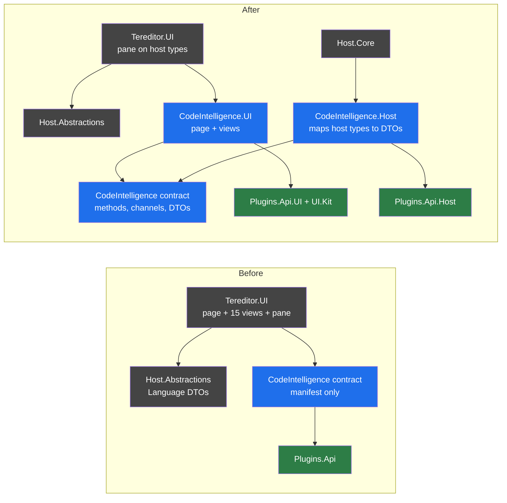

## Responsibility

The plugin `code-intelligence` is the one switch for the language features of the app. Builtin, enabled by default, wire
version 1, headless, no settings or UI half. Its contract declares the methods and channels the settings page will use (migration step 1: declared, not served yet; see the design below). Every language server plugin and Air Context require it.

## Where the line is

The host keeps the language services, the `lsp_*` agent tools, headless, the on-demand lifecycle and server
installation: agents and headless need them whatever the interface shows. The plugin governs what the interface shows.

## Dependency rule

A plugin lists the plugins it requires. Switching Code Intelligence off switches off every plugin that requires it, and
switching them back on is the user's: turning the base on does not bring them back. Enabling one of them while the base
is off is refused and says what it requires ("depends on code-intelligence, which is off"); the settings page offers
to switch the base on with it. A cycle is refused. This is the host's general dependency rule, not new.

## When the plugin is disabled

The host follows the same rule without any UI: with the plugin off every dependent language server plugin is off, so the
language catalog is empty, running servers stop, nothing starts or downloads, and no `lsp_*` tool is served. Saved
settings, installed servers and caches stay. At startup, before the first reconcile, a builtin server whose required
plugin is off is not offered either.

Settings lists the page as the plugin's own section, "Code Intelligence", under Plugins (key `plugin:code-intelligence:code-intelligence`; the old name `Code Intelligence` still opens it). The plugin's UI half registers the section; the page itself is still built by core's Settings view, since it needs the window and host state, so moving its code into the plugin is left for a later step. On Settings › Plugins the plugin sits in its own group, Code Intelligence, with Air Context; each language server stays in its language's group. The limits rows (idle timeout, memory budget, server caps) share one grid: label, a 128 px box column and one shared unit column.

There is no Code Intelligence settings section, no Language tool tab, strip entry or catalog entry, no language keymap
group, and in the editor no hover, go to definition, usages, diagnostics decorations, quick info or status chip. A saved
layout that names the Language tool restores without it and keeps its slot. Enabling the plugin brings all of it back.

## Design: the Code Intelligence page and its views move into the plugin

Status: design only. No production code changed. Written from the code at commit 853be7ae7.

### Facts the design rests on

- `Tereditor.UI/Panels/LspSettings.cs` (`SettingsView.LspSettings()`) builds the page. It calls `window.Host.LanguageAsync` (operations catalog, resolution, provision, configurationSchema, running) and `LanguageTermsAsync`, and writes host settings with `HostStateStore.ChangeAsync(HostStateChange.Setting(...))` for `lsp-enabled`, `language-server:<id>` and `language-limits`. It reads `Settings.LanguageServers`, `LanguageTools`, `LanguageLimits`, `JavaKotlinProvider` and `LspEnabled`.
- The page uses about 15 internal views in `Tereditor.UI/Panels`: `LanguageProviderView`, `LanguageLimitsView`, `LanguageDependencyList`, `LanguageTermsWindow`, `LanguageTermsStatus`, `LanguageProviderLinks`, `LanguageServerNameConverter`, `LanguageServerIconConverter`, `LanguageSourceIcon`, `LanguageNotes`, `OptionalNumberRow` and more. The Language tool pane (`LanguagePanel`, `LanguageConfigurationView`, `LanguageRunningView`, `LanguageLogsWindow`) uses most of them too.
- The wire types (`LanguageRequest`, `LanguageResult`, `LanguageServerState`, `LanguageTermsRequest`, `LanguageServerOptions`) live in `Tereditor.Host.Abstractions/LanguageServices.cs`.
- No plugin UI assembly references `Host.Abstractions`. All 22 plugin UI projects reference only `Plugins.Api`, `Plugins.Api.UI`, `Plugins.UI.Kit` and their own contract. `BoundaryChecks` enforces the layering.
- `IPluginUIContext` already has `RequestAsync<TParams, TResult>(PluginMethod, ...)` and `Subscribe<TPayload>(PluginChannel, ...)`. A plugin's UI reaches its host half through these.
- `IPluginHostContext` has `LanguageServer(LanguageServerSpec)` and `Settings<T>()` (the plugin's own settings namespace) but no member that reads or writes host settings by key and none that calls the language service.

### 1. Where the DTOs live

Recommendation: the Code Intelligence contract assembly (`Tereditor.Plugins.CodeIntelligence/Contract`), not a new `Api.Language` assembly.

- Only this plugin's UI and host half need the page DTOs. A shared assembly adds a public API with a second consumer that does not exist.
- The contract assembly is already referenced by `Tereditor.UI` (added in 853be7ae7) and by the plugin's UI half, so no new project reference is needed.
- The Language tool pane keeps the host types (see section 4). The contract DTOs are a smaller, page-shaped copy: a server row, a resolution result, a terms status, the limits and the provider choice. The host half maps host types to them in one place.

`Tereditor.UI` referencing `CodeIntelligence.UI` is the same direction every other builtin plugin already has (see `Tereditor.UI/Plugins/BuiltinPlugins.cs`), so `BoundaryChecks` allows it. The plugin UI never references `Host.Abstractions` or `Tereditor.UI`.

### 2. The host half

Methods (all `PluginMethod<TParams, TResult>`, in `CodeIntelligenceContract`, wire version stays 1 until shipped):

- `catalog`: no parameters; returns `LanguageCatalogState` (list of `LanguageServerRow`: id, version, detail, dependencies, presentation flags, hidden).
- `resolution`: `LanguageServerParams` (workspace, server); returns `LanguageResolution` (source, path, version, warning, path-capable, state, detail, pinning).
- `provision`: `LanguageServerParams`; returns `LanguageProvisionResult`.
- `configurationSchema`: `LanguageServerParams`; returns the schema JSON as a string plus state.
- `running`: workspace; returns `LanguageRunningState` (memory budget summary, running rows).
- `terms`: `LanguageTermsParams` (workspace, server, accept, artifact id, EULA hash); returns `LanguageTermsState`. Acceptance stays a UI-only call, as today.
- `setServerOptions`: server id and `LanguageServerOptionsDto` (allow PATH, command, arguments); returns the saved options.
- `setLimits`: the limits JSON string; returns the saved value.
- `setEnabled`: a bool; returns the saved value.
- `setProvider`: the Java and Kotlin provider id; returns the saved value.

Channels (state channels, so a late subscriber gets a snapshot):

- `settings`: `CodeIntelligenceSettingsState` (enabled, language servers JSON, tools JSON, limits JSON, provider). The host half publishes it from host state, so every client sees one state and the page updates on broadcast, never from a local copy. The host half never keeps the value; it re-reads host state.
- `catalogChanged`: a small counter payload that makes the page reload the catalog when plugins activate or deactivate (replaces the page's reliance on `PluginRegistry.Changed`).

Needed from `IPluginHostContext` (two narrow members, no Code Intelligence names):

- `ValueTask<string> HostSettingAsync(string key)` and `ValueTask SetHostSettingAsync(string key, string value)`, limited by a permission `host.settings` and by an allow-list of keys the host publishes (`lsp-enabled`, `language-server:*`, `language-limits`, `java-kotlin-provider`). It goes through `IHostStateService`, so saved-state keys and broadcast stay as they are.
- `IPluginLanguageAccess Language { get; }` with `ExecuteAsync(string operation, string json, CancellationToken)` returning JSON. It is a thin typed seam over `ProjectServices.LanguageAsync` and `LanguageTermsAsync`; no new language behaviour.

What stays in core: `LanguageService`, `LanguageServers`, the on-demand lifecycle, installation, the `lsp_*` MCP tools (`LanguageMcpTools`), headless hosting and the `language` wire operations. The host half is an adapter, not a second implementation.

### 3. UI-side surfaces

No new `IPluginUIContext` members. `RequestAsync` plus the methods above and `Subscribe` plus the two channels cover everything the page does. This is the smallest new public API: the only additions are the two `IPluginHostContext` members in section 2 (with `PublicAPI.Unshipped.txt` entries, new crossing hashes, isolation classification and a permission each). Both are host-only, so the UI table hash in `PluginCrossingChecks` stays the same.

Isolation classification: `HostSettingAsync`, `SetHostSettingAsync` and `Language` are host-side calls from the plugin's host half. In the isolated runtime they are pending (not carried yet), marked in source with the pending list. The builtin Code Intelligence plugin runs in process, so this blocks no one today.

### 4. The Language tool pane

Recommendation: the pane stays in core on host types.

- It is a workbench tool tied to docking (`LanguagePanel`, tool id `lsp`, `LayoutSession`, `LanguageSupport`), the Running section and the logs window. Moving it would make a core dock tool a plugin side tool and change saved layouts.
- It calls the language service on every poll and renders large lists; going through plugin methods would add a copy and a hop per refresh and risk the startup and frame budgets that `--lsp-ui` guards.
- Consequence: about 6 views that both the page and the pane use (`LanguageDependencyList`, `LanguageTermsStatus`, the name and icon converters, `LanguageSourceIcon`, `LanguageNotes`) exist twice for a while: the pane keeps the core copy on host types, the page gets a copy on contract DTOs. The duplication is bounded and can later collapse into `UI.Kit` if the pane's types are replaced by the contract DTOs. This is the one real cost of the recommendation.
- Dependent plugins: language server plugins keep `DependsOn code-intelligence`. Nothing changes for them, since they register through `IPluginHostContext.LanguageServer`.
- Headless: the host half and the page do not exist in headless (no UI). Agents and headless keep the `lsp_*` tools and the language service in core. `CodeIntelligenceHost` stays `Headless = Yes` and only the methods run there.
- Checks using `InternalsVisibleTo`: `LanguageLimitChecks`, `LanguageDependencyChecks`, `LanguageChecks`, `GlobalJvmProviderChecks`, `IntelliJLicenseChecks`, `AirContextChecks` and `AirContextWorkflowChecks` open the page by its old name or build the views directly. The views move to `Tereditor.Plugins.CodeIntelligence.UI`, so that assembly needs `InternalsVisibleTo Tereditor.Checks` (as `Runtimes.UI` already has) and the checks need a project reference. Checks that only open Settings keep working through the section alias.

### 5. Migration order

Every step ends green on the ten focused modes: `--code-intelligence-plugin`, `--lsp-limits`, `--lsp-settings`, `--lsp-ui`, `--lsp-dependencies`, `--lsp-narrow`, `--plugin-crossing`, `--plugins-settings`, `--context-ui` and `--boundary`, plus the format verify. A queue-heavy run is one build plus the modes; the estimate counts runs.

1. Contract DTOs and method and channel declarations, no behaviour (2 runs).
2. The two `IPluginHostContext` members with permissions, `PublicAPI.Unshipped.txt`, crossing pins and isolation pending entries, plus their host implementation and checks (3 runs).
3. `CodeIntelligenceHost` implements the read methods (catalog, resolution, running, configurationSchema) and the `settings` channel, with a check that compares them to `LanguageAsync` (3 runs).
4. The write methods (provision, terms, setServerOptions, setLimits, setEnabled, setProvider) with checks that saved-state keys and broadcasts are unchanged (3 runs).
5. Move `OptionalNumberRow`, `LanguageLimitsView` and their check (`LanguageLimitChecks.Ui`) to the plugin UI, on the methods (2 runs).
6. Move the provider view and links, then the dependency list, then the terms window and status, one commit each (about 2 runs each, 6 in total).
7. Move the page body (`LspSettings`) and register it through `SettingsSection`; delete `SettingsView.LspSettings` and the section alias special case, keeping the alias in `ShowSection` (3 runs).
8. Specs, the whole-solution format verify, `--persisted-json` (expected unchanged) and a final rebase (2 runs).

About 24 runs. At 5 to 10 minutes per queued run this is a day or two of wall time, not one session.

### 6. Risks and decisions

Risks:

- Two copies of the shared views (section 4) can drift. A check that renders both from the same fixture row would pin them.
- The page polls (running, catalog) through plugin methods; each call crosses the plugin channel. `--lsp-ui` and `--lsp-narrow` guard the frame and UI-thread rules, and `LanguageChecks` must keep proving no request runs on the UI thread.
- The host settings seam is a new write path for plugins. It must stay allow-listed, or any plugin could write any host setting.
- The isolated runtime cannot carry the new host members yet; this only matters once Code Intelligence is isolated, which nothing plans.

Decisions the user still has to make:

1. Accept the contract assembly as the home of the DTOs (recommended) or ask for a shared `Api.Language`.
2. Accept that the Language tool pane stays in core, with the bounded duplication of shared views (recommended), or move the pane too.
3. Accept the two new `IPluginHostContext` members and their allow-list model, or allow only plugin-specific host methods through a core callback.
4. Accept about 24 queued runs, spread over several sessions, with a commit per step.
